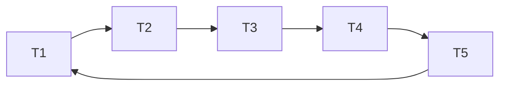

# Basics of 2PL

prerequisite [[Concurrency Control]]
2 PL is a type of pessimistic concurrency control technique
**Phases**

1. phase1:
   - txn request for lock by lock manager
   - lock manager either grant or denied the lock request (denied if other txn has placed the locked on it already)
2. phase2:
   - Txn can not aquire any new locks
   - Txn is only allowed to release the lock which is taken previously.

# 2PL

| Time | T1      | T2     |
| ---- | ------- | ------ |
| t0   | Begin   |        |
| t1   | X(A)    |        |
| t2   | X(B)    |        |
| t3   | process |        |
| t4   | U(A)    | Begin  |
| t5   | U(B)    | X(B)   |
| t6   | Commit  | X(A)   |
| t7   |         | Commit |

## Drawbacks

**Deadlock**
**Cascading aborts**

## Solutions

### Deadlock solution

#### Timeout

in this strategy, scheduler find out that TXN is waiting too long for the lock, it simply assumes that there might be a deadlock involving this transaction and thus abort it.
**Problem with approach**: schedule can make mistake(what if T1 wait for the lock, which is aquired by other T2 which is just long time to finish)

#### Direct graph called Wait for Graph(WFG)

There will be an edge from node Ti to Tj, scheduler delete the edge, whenever lock is release by particular TXN which is causing some other TXN to wait

whenever a cycle is detected the scheduler needs to stop a TXN aka **Victim TXN**
Choosing the victim TXN:

- The amount of effort TXN has put till now
- The amount of effort required to finish the TXN
- The cost of aborting the TXN (cost generally means here is how many updates already has been done)
- The number of cycles that contains the transaction

#### Conservative 2PL (AKA static 2PL)

- Avoid deadlock by requiring each TXN to acquire all the locks at start of the TXN itself
- Each TXN, predeclared its read and write operation to the scheduler
- scheduler tries to set all the lock needed by TXN
- If scheduler fails to acquire any lock, none of the lock will be granted to TXN and it will wait
- CONS: **less Concurrency**

#### Timestamp based deadlock transaction

Older the transaction higher is the priority of the transaction

##### Wait -Die:

- old TXN waits for New TXN
- ts(T1) < ts(T2) => T1 will wait for T2 to get completed, otherwise TXn will get aborted

##### Wound-Wait

- old txn five would to the new TXN and make them aborted
- ts(T1) < ts(T2) => T2 abort and releases its lock otherwise TXN will wait

### Cascading aborts solution

| Time | T1       | T2                            |
| ---- | -------- | ----------------------------- |
| t0   | Begin    | Begin                         |
| t1   | X(A)     |                               |
| t2   | X(B)     |                               |
| t3   | update A |                               |
| t4   | U(A)     |                               |
| t5   |          | X(A)                          |
| t6   |          | some opr                      |
| t7   | Abort    |                               |
| t8   |          | This needs to be aborted also |
| t9   |          |                               |

#### Strong Strict 2PL(AKA Rigorous 2PL)

- TXN is not allowed to acquire or upgrade more lock after growing phase
- Release all the locks at the end of the TXN only
- CONS: less concurrency + deadlock

---

# Related

[[Concurrency Control]]

---

# References / Sources

