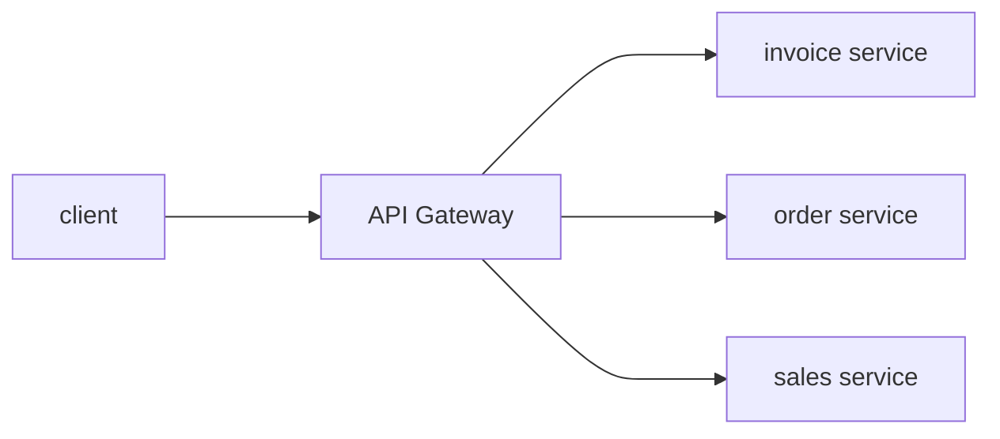
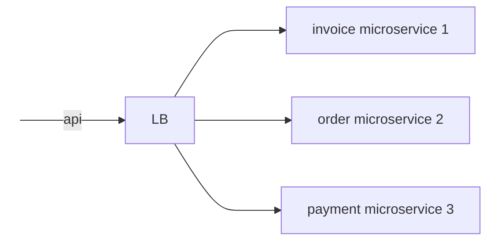
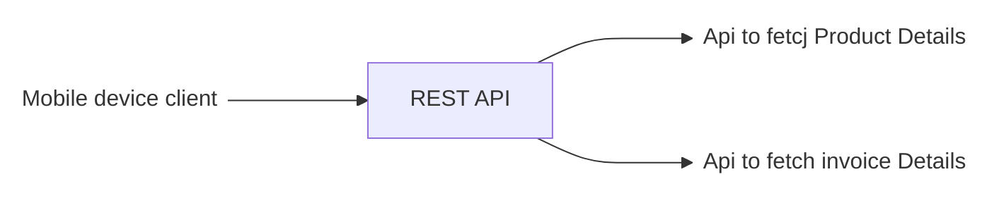
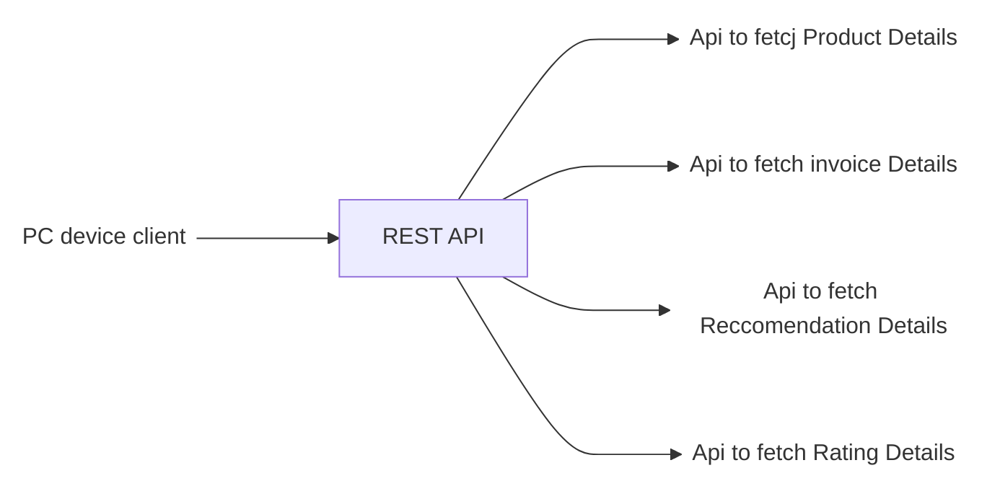
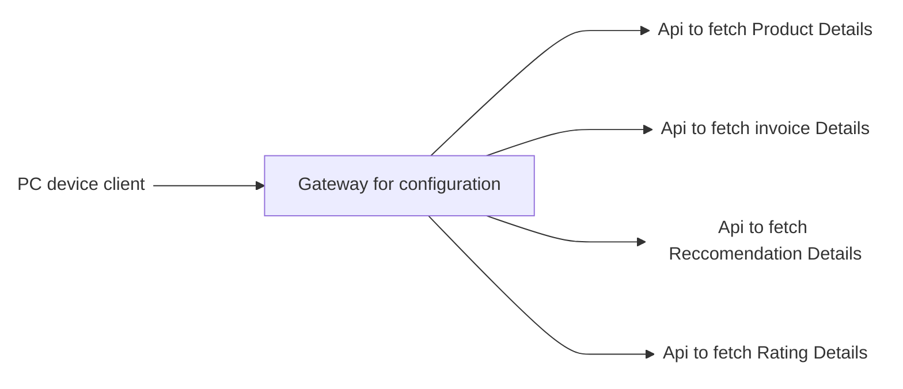
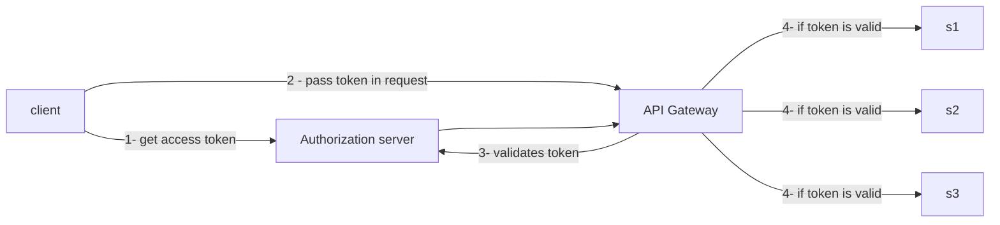
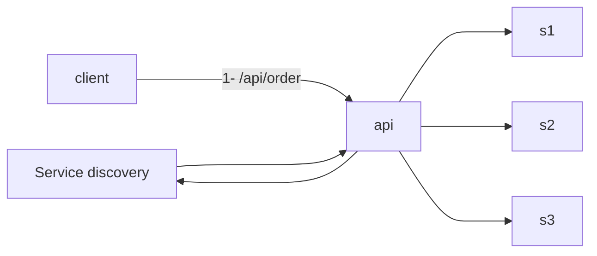
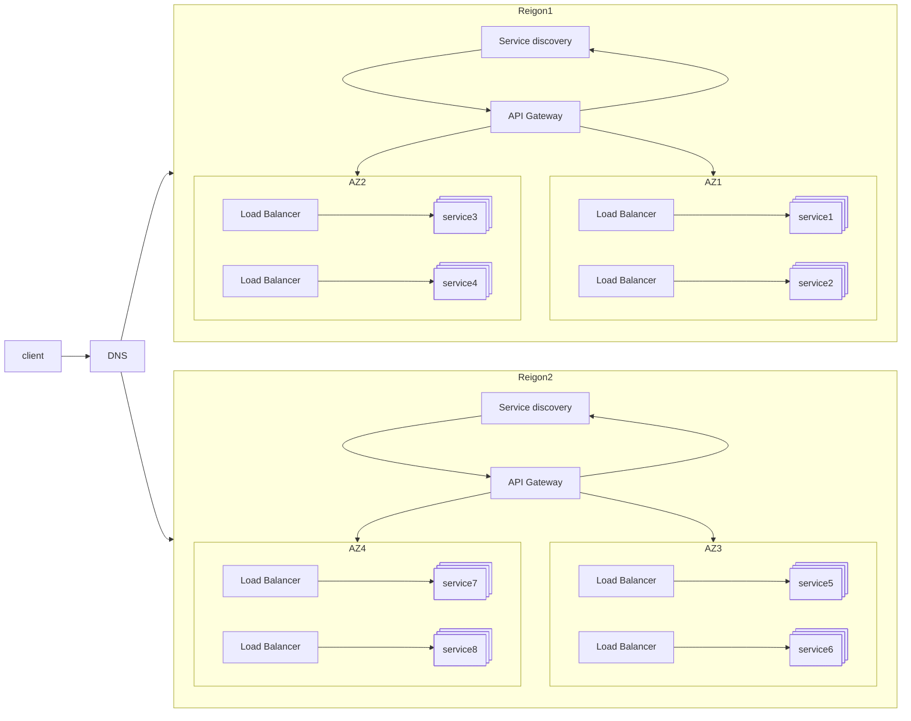

IF **API Gateway** a single entry point, how does it handle millions of request per second?
also
How **API Gateway** is different from load balancer? Does it comes before or after load balancer?

# What is API Gateway

In simple terms, it accepts the client API request and routes them to correct backend service based on API endpoint.

**Isn't this what load balancer also does?**
No, Generally load balancer simply distribute the traffic to the multiple instances of  a microservice based on various factors like health, traffic load, etc.
But usually they dont have capability to understand an API and then take decision to route it.

Apart from routing api gatewaus does more

## 1. API Composition

problem: lets say, we are visiting **My orders** page.

Solution using api composition

## 2. Authentication

## Rate limiting

We can set rules like:

#### Manage Burst limit:

Use to limit the Burst traffic, means max no. of concurrent request that AOU Gateway can handle before it returns 429(Too many requests)

#### API Throttling

Limiting the number of requests from an individual or an application by temp blocking the request, once they ceossed the allowed request rate.

#### IP Based blocking

#### API Queues

Hold requests to an API, which can not be processed immediately. It helps to handle the Thundering herd effect

## Service Discovery

As mivrosevices can scale up and down, its necessary to know the location(IP  address and Port). Service Discovery keep tracks of those.

- **Approach1** -> Each Microservice register or de register themselves.
- **Approach2** -> Service Discovery, keeps health check of all the registered microservices and keep only active microservices location.

And many other capabilities like:

- Request Response transformation
- Response caching
- Logging

Now lets come back to question
**If api gateway is a single  entry point, how does it handle millions of requests per second?**

---

# Related

[[Web servers and API gateways]]

---

# References / Sources

