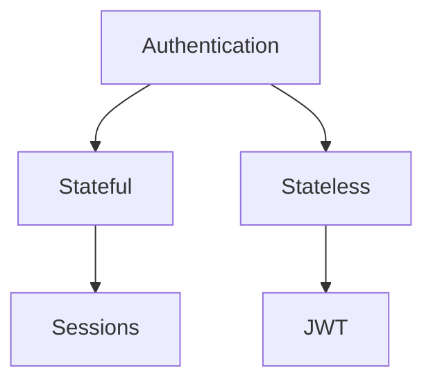
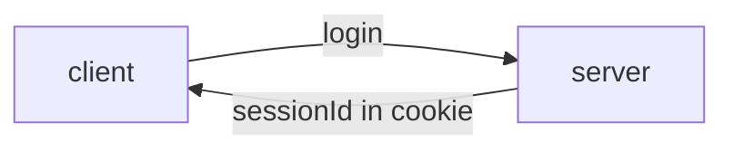
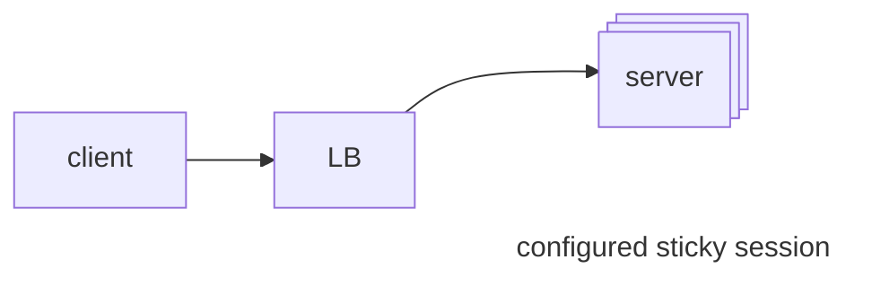
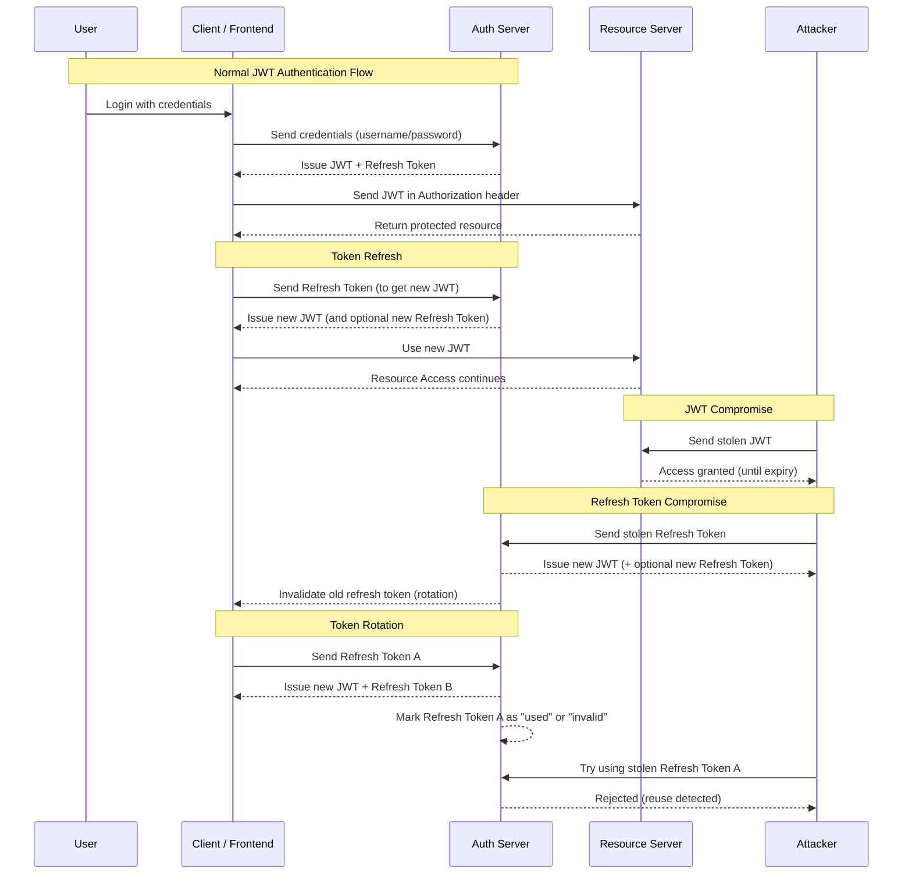

# Authentication



# Sessions (Stateful)



It is harder to scale server horizontally, as the server saving the session Id may not serve the authenticated request which was earlier served by the server that generated the session Id.
To solve this we introduced `sticky sessions` in load balancer that ensures the request for a user is served by a server that generates its sessions



Not to configure sticky sessions, we can store the session ids in an in memory database like Redis

```mermaid
flowchart LR
client --> LB --> s --> D
s@{shape: processes, label: server}
D@{img: https://cdn.jsdelivr.net/gh/devicons/devicon@latest/icons/redis/redis-original.svg, label: Redis}
```

But this storage is expensive

# JWTs

JWTs can be stateless or semi stateless



---

# References


