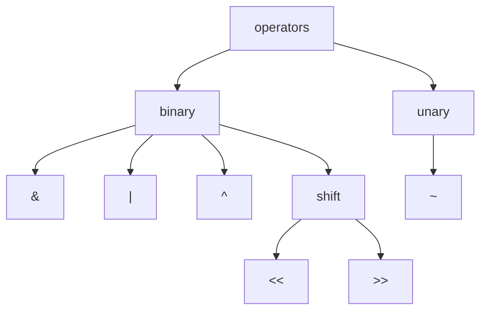

# Number System

1. **Positional Number system**: where a character position determines its value, example: Binary, Octal, Decimal, Hexadecimal
2. **Non Positional Number system**: where a character position has no effect on value of number, example: Roman number system

## Positional Number system

# Bitwise operators



## Truth Table

| a   | b   | a | b | a & b | a ^ b |
| --- | --- | ------ | ----- | ----- |
| 0   | 0   | 0      | 0     | 0     |
| 0   | 1   | 1      | 0     | 1     |
| 1   | 0   | 1      | 0     | 1     |
| 1   | 1   | 1      | 1     | 0     |

## Properties

```tabs
tab: AND
1. $x\&0=0$
2. $x\&x=x$
3. $x\&(2^{k}-1)=x \% 2^{k}$
4. $x\&(-x)$ is used to seprate lowest setbit
   
tab: OR
5. $x|0=x$
6. $x|x=x$
7. $x \mid y=x+y-(x\&y)$
   
tab: XOR
8. $x\oplus 0=x$
9. $x\oplus x=0$
10. $x\oplus y=y\oplus x$
11. $(x\oplus y)\oplus y=x$
12. $x\oplus y = (x+y)\%2$
13. $x+y=(x\oplus y)+2(x\&y)$

tab: Shift
1. $x << k = x.2^k$
2. $x >> k = \lfloor\frac{x}{2^k}\rfloor$
3. $x << 0 = x >> 0 = x$
4. $(x << a) << b = x << (a+b)$
5. $(x >> a) >> b = x >> (a+b)$
6. $(x << k) >> k \neq x$
```

## Working of Shift Operators

> Shift operators use a 0-fill / sign-fill and discard mechanism on numbers

> [!warning]
> Shifting is not cyclic

Below is the first principles for shifting

```tabs
tab: Left shift
1. bits move left
2. left k bits are discarded
3. right side gets k 0's

tab: Right shift
1. bits are moved right
2. for unsigned integers
   a. right k bits are discarded
   b. left side gets k 0's
3. if signed integers and msb is 1
   a. right k bits are discarded
   b. left side gets k-1 0's and msb remains unchanged
```

**Cyclic Rotation**

1. $ROL(x, k)=(x\ll k) \mid (x \gg(w-k))$
2. $ROR(x,k)=(x\gg k)\mid(x\ll(w-k))$

# Integer width, Representation and Complements

An Integer with arbitrary width `w` is represented as
$b_{w}\dots b_{2}b_{1}b_{0}$
so total number values this width can represent is $2^{w}$ irrespective of Interpretation.
That is equivalent to placing 2 types of things at w places, here its 0 and 1 at w places.

For each representation the unsigned value can be determined as $U = \sum_{i=0}^{k}b_{i}2^{i}$ and signed value can be determined as $V= \begin{cases} U,&MSB=0\\[2mm] U-2^w,&MSB=1 \end{cases}$

| Integers | Range                   | 1s = `~x`   | 2s = `~x+1` |
| -------- | ----------------------- | ----------- | ----------- |
| Unsigned | $[0, 2^{w}-1]$          | $2^{w}-x-1$ | $2^{w}-x$   |
| Signed   | $[-2^{w-1}, 2^{w-1}-1]$ | $-x-1$      | $-x$        |
Common width and integer range

| W   | Unsigned Range | Signed Range |
| --- | -------------- | ------------ |
| 1   | $[0,1]$        | $[0, -1]$    |
| 2   | $[0,3]$        | $[-2, 1]$    |
| 3   | $[0,7]$        | $[-4,3]$     |
| 4   | $[0,15]$       | $[-8,7]$     |

> [!warning]
>
> $$
> w\neq Radix\neq \text{Bits per digit}
> $$
>
> - Bits Per digit = $\log_{2}(Radix)$
> - $[w]_{binary}=\lceil  \frac{w}{Radix}  \rceil$
> - w=3 can represent binary, complete octal numbers, hexadecimal upto 7
