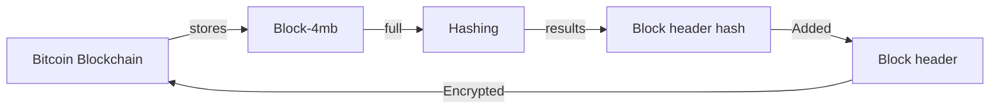
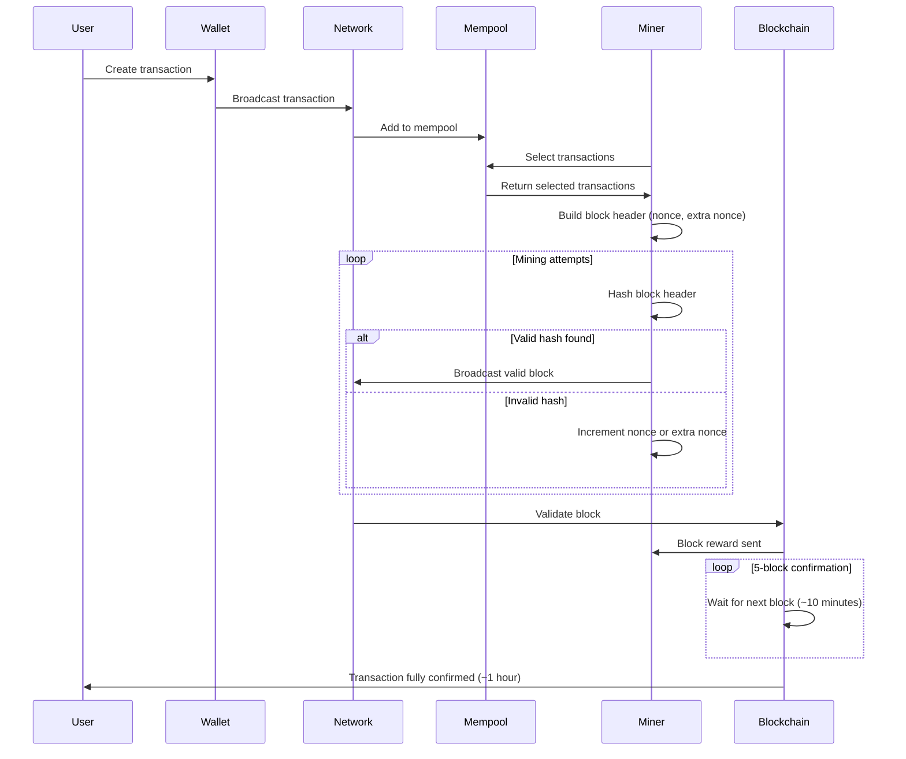
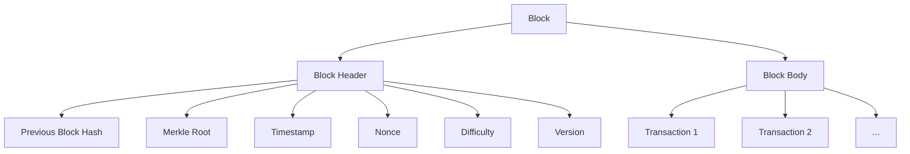

# Intro

## What is Blockchain?

- A blockchain runs on a computers worldwide
- Each system stores data and transactions in an immutable shared ledger (document)
- we say its immutable but techically its difficult to change state
- In web2 companies store this data in databases
- so basically blockchain is a distributed immutable database or ledger to store data and transactions

## Blockchain clients

- anyone can run blockchain network by using open source known as blockchain clients
- any machine running a client is called node

## Applications

- cryptocurrencies
  - L1, L0, L3 cryptocurrencies
- DAAPs/DAOs using smart contract aka web3 blockchains
  - DeFI/NFTs
  - wallets
  - Decentralized Exchanges
  - Centralized Exchanges
  - Healthcare to store records of health data using blockchain
  - Property records, property ownership, land ownership
  - supply chain authenticity
  - voting to eliminate election fraud
- A Partial DAAP
  A business can earn profit in Web3, but not through full decentralization.
  The winning formula is a hybrid model: centralized business logic and monetization, combined with decentralized components like
  wallets, tokens, and smart contracts. This is what exchanges, casinos, marketplaces, and wallets all do.

# Working

## How Blockchain works?

## Transaction Process

### When is a valid hash found by a miner?

It is when the hash found by miner has the difficulty less than or equal to given difficulty of the transactoin block, so he guesses the nonce and extran nonce to guess the valid hash

### Nonce and Extra Nonce

short for number used once. The nonce is like a guess. Its like revese hashing, hashing can only be reversed by guessing
Miners keep changing this guess over and over, It’s just a number that miners change repeatedly to try to get the winning result.

### Consensus

Consensus is the method used so that all nodes agree on a single, valid chain.
Different blockchains use different mechanisms:

- Proof of Work (PoW)
- Proof of Stake (PoS)
  Every blockchain consensus mechanism — Proof of Work, Proof of Stake, DPoS, BFT, etc. — is built from two core components:

1. Sybil Resistance Mechanism
2. Chain Selection Rule (Fork-Choice Rule)
   These two together ensure that the network is secure, decentralized, and can agree on a single chain of blocks.

**Sybil Resistance Mechanism**
A “Sybil attack” happens when someone creates a large number of fake identities (nodes) to gain majority influence in the network.

| Mechanism | Scarce Resource              |
| --------- | ---------------------------- |
| PoW       | Computational power (energy) |
| PoS       | Economic stake (coins)       |

**Chain Selection Rule (Fork-Choice Rule)**
In a decentralized network, multiple valid blocks may appear at the same time. This creates forks. Nodes must have a rule to decide:
Which chain do we consider the “true” one? This determines how the blockchain converges on a single shared history.

| Consensus Type / Blockchain                   | Fork-Choice Rule                                   | How It Works                                                                                                                                                    | Why It Matters                                                                                               |
| --------------------------------------------- | -------------------------------------------------- | --------------------------------------------------------------------------------------------------------------------------------------------------------------- | ------------------------------------------------------------------------------------------------------------ |
| **Proof of Work**                   | **Longest Chain with Most Cumulative Work**        | Nodes choose the chain with the highest total accumulated hashpower, _not just number of blocks_.                                                               | Ensures attackers must outperform total network hashpower to reorganize blocks; prevents easy double-spends. |
| **Proof of Stake** | **LMD-GHOST + Casper FFG Finality**                | **LMD-GHOST:** Picks chain with highest stake-weighted attestations.   **Casper FFG:** Finalizes blocks when ≥2/3 validators sign, making them irreversible. | Provides fast convergence + strong finality; prevents long-range attacks and deep reorgs.                    |

**Comparing popular blockchains on the basis of consensus**

| Feature                                | **Bitcoin**                                 | **Ethereum (Post-Merge, PoS)**                                          | **Solana**                                                        |
| -------------------------------------- | ------------------------------------------- | ----------------------------------------------------------------------- | ----------------------------------------------------------------- |
| **Consensus Mechanism**                | **Proof of Work (PoW)**                     | **Proof of Stake (PoS)**                                                | **Tower BFT (PoS-based)**                                         |
| **Sybil Resistance Mechanism**         | **Hashpower (Energy + Mining Hardware)**    | **Staked ETH** (economic cost)                                          | **Staked SOL + Voting**                                           |
| **Block Production**                   | Miners solve PoW puzzles                    | Validators propose blocks in assigned slots                             | Leaders produce blocks in scheduled slots                         |
| **Fork Occurrence**                    | Frequent temporary forks                    | Short-lived forks possible, resolved via LMD-GHOST                      | Possible during network desync; resolved by BFT voting + lockouts |
| **Fork-Choice Rule (Chain Selection)** | **Longest chain with most cumulative work** | **LMD-GHOST** (stake-weighted heaviest chain) + **Casper FFG finality** | **Stake-weighted voting + Lockouts** (Tower BFT)                  |
| **Finality Model**                     | _Probabilistic_ (6 confirmations)           | _Economic Finality_ (≥2/3 validators sign checkpoint)                   | _Probabilistic + BFT finality_ via lockouts                       |
| **Attack Cost**                        | Control >50% of global hashpower            | Control ≥33% stake to halt finality; ≥66% to finalize malicious blocks  | Control large stake + break lockout rules                         |
| **Double-Spend Resistance**            | Very strong (requires huge hashpower)       | Very strong (slashing prevents long-range attacks)                      | Strong (validators locked out from switching forks)               |
| **Energy Usage**                       | Very high                                   | Extremely low                                                           | Low                                                               |

### Incentive Models in blockchain

| Incentive Type                | Used In              | Purpose                                       |
| ----------------------------- | -------------------- | --------------------------------------------- |
| **Block Rewards**             | PoW & PoS            | Reward block production; bootstrap network    |
| **Transaction Fees**          | All chains           | Prioritize transactions, prevent spam         |
| **Staking Rewards**           | PoS                  | Incentivize capital commitment                |
| **Slashing**                  | PoS                  | Punish misbehavior; enforce honesty           |
| **Mining Costs (Energy)**     | PoW                  | Make attacks economically expensive           |
| **Delegation Incentives**     | PoS                  | Encourage validator competition & performance |
| **Governance Rewards**        | DAO/PoS systems      | Promote community participation               |
| **Storage Incentives**        | Filecoin/Sia/Arweave | Reward decentralized data storage             |
| **Bridge/Relayer Incentives** | Cross-chain networks | Secure and maintain interoperability          |

# Structure

# Blockchain Interoperability

Blockchain Interoperability refers to the ability of different blockchain networks to communicate, exchange data, and transfer assets with
each other, even though they may have different architectures, consensus mechanisms, and rules.

## Types

| Type of Interoperability                        | What It Enables                                                        | How It Works (Simplified)                                                   | Examples of Systems/Bridges                              |
| ----------------------------------------------- | ---------------------------------------------------------------------- | --------------------------------------------------------------------------- | -------------------------------------------------------- |
| **1️⃣ Asset Transfer (Token Interoperability)** | Moving tokens from one chain to another                                | Lock assets on Chain A → Mint wrapped assets on Chain B                     | Wormhole, Polygon Bridge, Avalanche Bridge               |
| **2️⃣ Data Interoperability**                   | Chains share state or messages                                         | Smart contracts send messages across chains; oracles relay cross-chain data | Cosmos IBC, LayerZero, Chainlink CCIP                    |
| **3️⃣ Smart Contract Interoperability**         | A smart contract on Chain A directly calls a smart contract on Chain B | Cross-chain function calls enabling unified multi-chain dApps               | LayerZero, Axelar, Polkadot XCM, IBC-based ICS contracts |

## How Interoperability works

| Method                                   | How It Works                                                                  | Strengths                                     | Weaknesses                                                       | Examples                                                |
| ---------------------------------------- | ----------------------------------------------------------------------------- | --------------------------------------------- | ---------------------------------------------------------------- | ------------------------------------------------------- |
| **Method 1: Trusted Bridges**            | Use relayers/oracles to verify events between chains                          | Fast, widely supported                        | Requires trust in operators; most bridge hacks target this model | Multichain, Wormhole (partially trusted), older bridges |
| **Method 2: Light Client–Based Bridges** | Each chain verifies the other’s state using cryptography and consensus proofs | Highly secure, no central trust               | More complex; computationally expensive                          | Cosmos IBC, Near Rainbow Bridge                         |
| **Method 3: Messaging Protocols**        | Network of validators/relayers pass messages between chains                   | Supports both data + token transfer; flexible | Security depends on validator set                                | LayerZero, Axelar, Wormhole (guardian network)          |

# Storage Mechanism

Decentralized storage in the blockchain ecosystem refers to systems that store data across many distributed nodes, instead of keeping it on
a single centralized server.
Because blockchains themselves cannot store large data (block gas limits, high cost).
So systems like IPFS, Filecoin, Arweave, and Storj store:

- Application data
- NFTs metadata
- Smart contract files
- Backups, documents, media, etc.

| Network              | Type                                      | Key Idea                                              | Strength                                     |
| -------------------- | ----------------------------------------- | ----------------------------------------------------- | -------------------------------------------- |
| **IPFS**             | Peer-to-peer file system                  | Addresses files by _content hash_ instead of location | Fast retrieval, foundation of Web3 storage   |
| **Filecoin**         | Blockchain + incentives on top of IPFS    | Miners earn FIL for storing files provably            | Verifiable storage guarantees, huge capacity |
| **Arweave**          | Permanent storage (PermaWeb)              | Pay once → store forever                              | Long-term immutable storage                  |
| **Storj**            | Distributed cloud storage                 | Encrypted file sharding across global nodes           | Privacy & reliability, enterprise-friendly   |
| **Sia (Skynet)**     | Incentivized decentralized storage        | Smart contract-based renting of storage               | Strong privacy via encryption/sharding       |
| **Swarm (Ethereum)** | Native decentralized storage for Ethereum | Incentive layer with BZZ token                        | Ethereum-aligned decentralized web           |

# Crypto Wallets

A crypto wallet is a tool (software or hardware) that stores your private keys and lets you send, receive, and manage cryptocurrencies.

## Types

| Wallet Type               | Hot/Cold | Custodial?    | Best For                     | Examples          |
| ------------------------- | -------- | ------------- | ---------------------------- | ----------------- |
| **Browser Wallet**        | Hot      | Non-custodial | DeFi, NFTs                   | MetaMask, Phantom |
| **Mobile Wallet**         | Hot      | Non-custodial | Payments, Web3               | Trust Wallet      |
| **Desktop Wallet**        | Hot      | Non-custodial | Medium security              | Electrum, Exodus  |
| **Hardware Wallet**       | Cold     | Non-custodial | Long-term storage            | Ledger, Trezor    |
| **Paper Wallet**          | Cold     | Non-custodial | Maximum isolation            | Printed keys      |
| **Multi-Sig Wallet**      | Hot/Cold | Non-custodial | Organizations, high security | Gnosis Safe       |
| **Smart Contract Wallet** | Hot      | Non-custodial | Recovery, high UX            | Argent, Safe      |
| **Exchange Wallet**       | Hot      | Custodial     | Beginners                    | Binance, Coinbase |

# Blochain oracles

Blockchain oracles are systems that allow blockchains and smart contracts to access external, real-world data that is not natively available on the blockchain.
Blockchains themselves cannot directly fetch external information — they are isolated for security reasons.
Oracles act as a bridge between the blockchain and the outside world.

**Hybrid smart contracts**
Hybrid smart contracts are smart contracts that combine on-chain code (blockchain logic) with off-chain data and computation (via oracles).

## Types

| Oracle Type                               | What It Does                                            | Examples of Data                                    | Used By / Examples                          |
| ----------------------------------------- | ------------------------------------------------------- | --------------------------------------------------- | ------------------------------------------- |
| **Inbound Oracle**                        | Brings off-chain data _into_ the blockchain             | Price feeds, weather, flight delays                 | Chainlink price feeds, API3 dAPIs           |
| **Outbound Oracle**                       | Sends blockchain events _out_ to real-world systems     | Smart contract triggers IoT, bank API notifications | IoT systems, payment gateways               |
| **Cross-Chain / Interoperability Oracle** | Transfers data or messages between blockchains          | State proofs, token transfers, cross-chain calls    | LayerZero, Axelar, Wormhole, Chainlink CCIP |
| **Decentralized Oracle**                  | Uses multiple independent nodes to supply trusted data  | Price feeds, randomness, aggregated market data     | Chainlink, Pyth Network, Witnet             |
| **Centralized Oracle**                    | Single entity provides data                             | One server posting price feed                       | Custom APIs, enterprise systems             |
| **Computation Oracle**                    | Performs off-chain computation & sends verified results | Random numbers (VRF), heavy calculations            | Chainlink VRF, Chainlink Functions          |

## Examples

| Oracle Network                    | Specialization                                                           |
| --------------------------------- | ------------------------------------------------------------------------ |
| **Chainlink**                     | Decentralized data feeds, VRF (randomness), CCIP (cross-chain messaging) |
| **Pyth Network**                  | High-frequency market data sourced from exchanges & trading firms        |
| **Band Protocol**                 | Cross-chain oracle for data feeds across multiple blockchains            |
| **API3**                          | API providers run first-party decentralized oracles (dAPIs)              |
| **Witnet**                        | Fully decentralized oracle network with on-chain data validation         |
| **LayerZero / Axelar / Wormhole** | Cross-chain messaging & interoperability oracles                         |

# Reference

- [introduction-video](https://youtu.be/4ff9esY_4aU)  [introduction-article](https://www.investopedia.com/terms/b/blockchain.asp)
- [proof of work based consensus and working](https://www.youtube.com/watch?v=bBC-nXj3Ng4)
- [wallet](https://www.youtube.com/watch?v=SQyg9pyJ1Ac)
- [Ethereum](https://www.youtube.com/watch?v=gh5b-MzDl6I)
- [gpt](https://chatgpt.com/share/69360d17-d384-8005-b739-0d53bad63ee2)
- [oracles](https://www.youtube.com/watch?v=m64dLRjJ9Bs)
