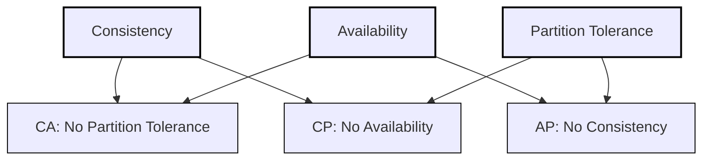

> Desirable property of distributed systems with replicated data

\--- start-multi-column: ID\_xqwq

```column-settings
Number of Columns: 3
Largest Column: standard
```

Consistency
![[System/Assets/osl0x5dc.bmp]]

\--- column-break ---

Availability
![[System/Assets/cuzpkjyt.bmp]]

\---column-break---

Partial Tolerance
![[System/Assets/pvo3qh18.bmp]]

\--- end-multi-column

---

# Trade offs

All distributed system can have at most two capabilities

- CA - User should not query until when partition happens
- AP - User can query from any node when partition happens with inconsistency
- PC - User can query from only available nodes when partition happens with consistency

Partition tolerance is the main component of any distributed system which cannot be traded off AP and PC are important factors


