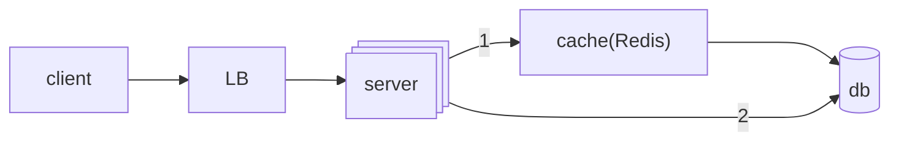
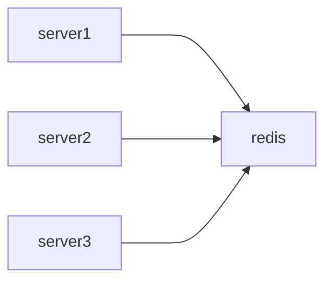
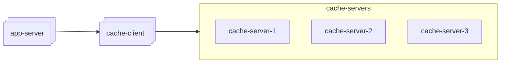
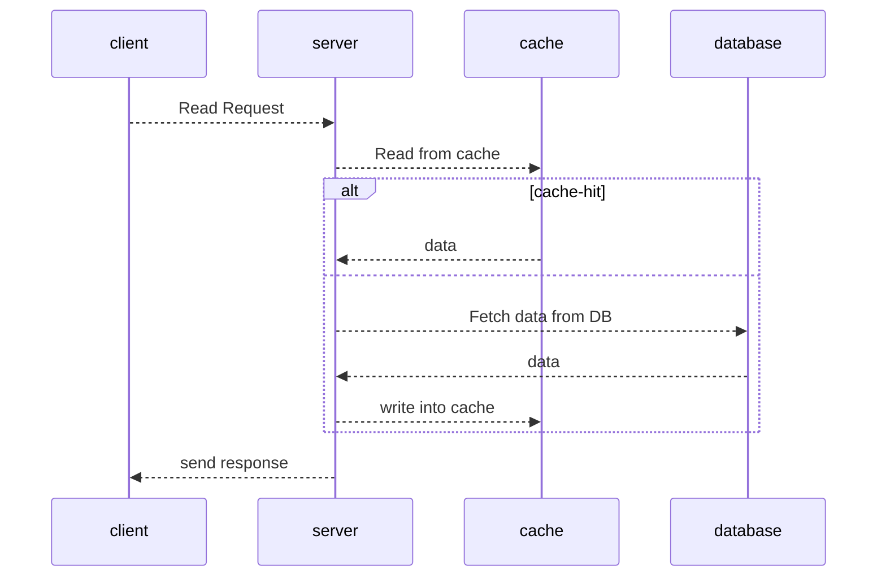
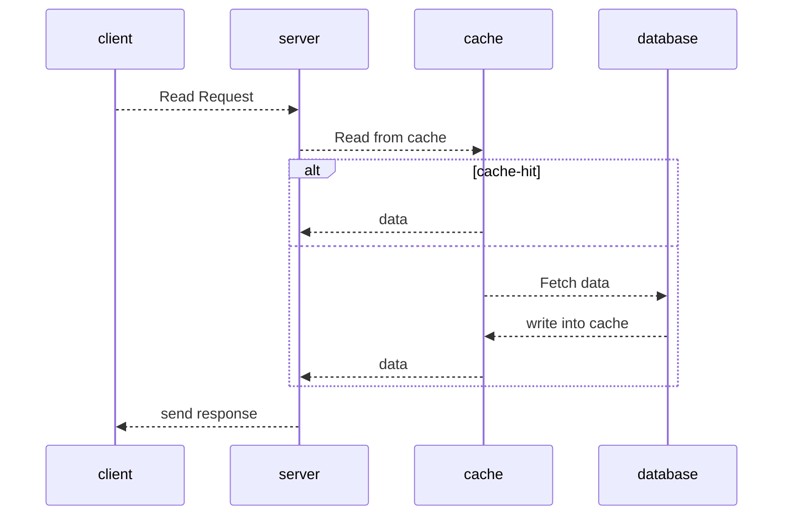
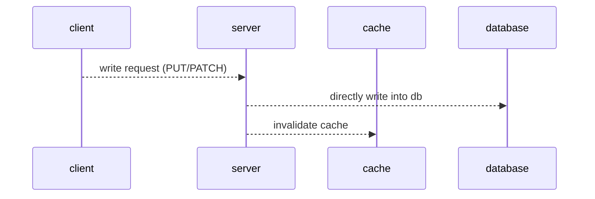
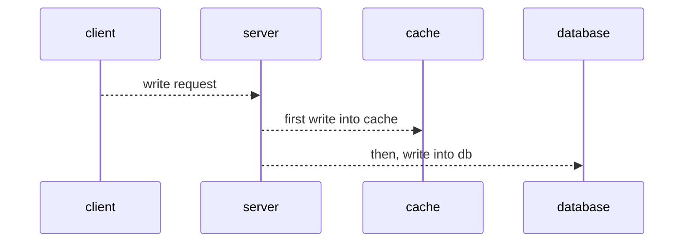
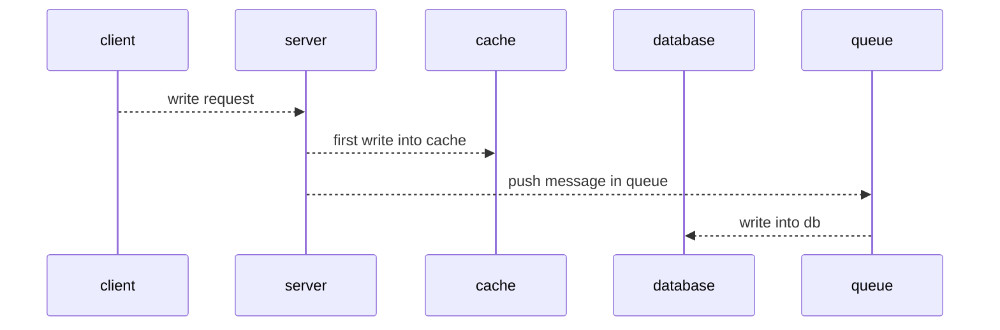

# What is Caching?

Caching is a technique to store frequently used data in a faster access memory rather than accessing data every time from slow access memory.
**Slow Memories** -> HDD, DB
**Fast Memories** -> RAM

- It makes our system very fast
- It helps reduce latency
- It also helps to achieve the fault tolerance
  **Caching at stages**
- client side **browser caching** and **request caching**
- CDN
- Load balancer
- server side **Redis Caching** (Important)

## Single caching server

### Disadvantages

- Scalability
- single point of failure

## Distributed caching

Each app-server is assigned a cache-client and cache-servers uses consistent hashing for the purpose of allotment. see here [[Hashing and Consistent Hashing]]

# Caching Strategies

## 1. Cache Aside

- application first check the cache
- if data found in the cache, its called cache hit and data is returned to the client.
- if data is not found, its called cache miss, application fetch the data from the DB, store it back to cache and data is returned to the client

### PROS

- Good approach for heavy read applications
- Even cache is down, request will not fail, as it will fetch the data from DB
- cache document data structure can be different from than the data present in the DB

### CONS

- for new data read, there will always be **Cache miss first**. To resolve this we can pre heat the cache
- without appropriate caching is not used during write operation. there is a chance of inconsistency between cache and DB

## 2. Read through cache

- application first check the cache
- if the data found in cache, its called cache miss. cache library itself fetch the data from DB, store it back to cache and data is returned to the application.

### PROS

- good approach for heavy read application
- logic of fetching the data form DB and updating cache is separated form the application.

### CONS

- for new data read, there will always be **Cache miss first** same resolution as above
- without appropriate caching is not used during write operation. there is a chance of inconsistency between cache and DB
- cache document structure should be same as DB table

## 3. Write around cache

- directly write data into DB
- it do not update the caache
- we invalidate cache on write

### PROS

- Good approach for heavy read application
- resolves inconsistency problem between cache and DB

### CONS

- for new data read, there will be always  be **Cache miss first** dame resolution as above
- if DB is down, write operation will fail

## 4. Write through cache

- first write data into cache
- then in sync manner write data into DB
- if any of them fail then we need to handle the exceptions accordingly

### PROS

- cache and DB always remains consistent
- cache hit chances increases a lot

### CONS

- alone its not useful, we need to use it with cache aside or read through cache
- 2 phase commit is needed to be implemented, either both will success or both will fail
- it is not totally fault tolerant, if either of them goes down write will not work

## 5. Write Back(or Behind) Cache:

- first writes data into cache
- then in async manner writes data into DB

### PROS

- independent if DB service is up, we can suffer DB down time for the cache server turn around time, fault tolerance increases
- good for write heavy application, write latency decreases as writing into cache is faster than writing into DB
- gives much better performance when implemented with read-through cache

### CONS

- fault tolerance absence when DB is still down after cache server turn around time TTL

---

# Related

[[Hashing and Consistent Hashing]]

---

# References / Sources

