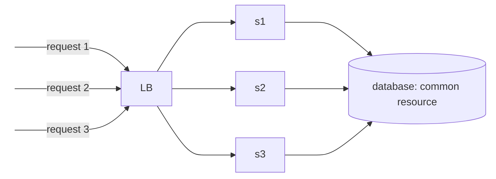
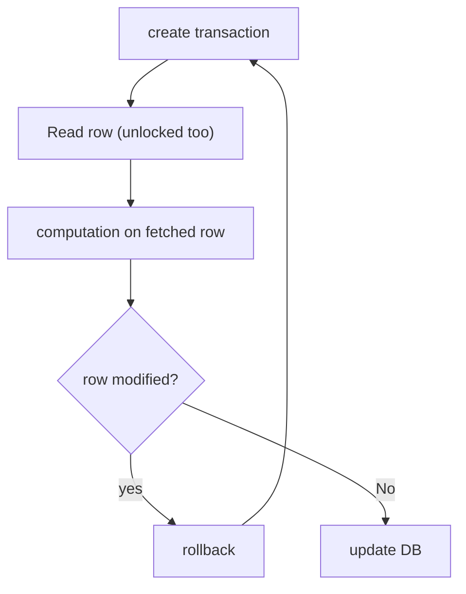

# Concurrency

_Scenario_ -> Many concurrent request tries to book same movie threatre seat


```python
Read Seat Row with ID: 10
# critical section
if Free:
	update status to Booked
	update the DB
```

Concurrency -> **Multiple request trying to access single resource**

## Solutions

### SYNCHRONIZED BLOCK

```python
synchronized {
	Read Seat Row with ID: 10
	# critical section
	if Free:
		update status to Booked
		update the DB
}
```

This will allow only one request in the critical section
This can work where single process(with multiple threads), will this work for distributed systems, (for multiple processes)?



## Distributed Concurrency Control

### Some Important stuff

#### Usage of Transaction

Transaction helps to acheive integrity, means it helps us to avoid inconsistency in our database

#### DB Locking

No other transactions updated the locked rows
Types of shared locks

1. **Shared lock** is known as read lock, only read can happen, it restrict any other transaction to update or write on the locked record or row
2. **Exclusive lock** neither allows reading or writing on the record via any transaction

| Lock Type            | Another Shared lock | Another Exclusive lock |
| -------------------- | ------------------- | ---------------------- |
| Have shared lock     | Yes                 | No                     |
| Have Exclusive locks | No                  | No                     |

#### Isolation Level

In ACID property, isolation signifies that even in multiple parallel transactions taking place each transaction feels to be proceeding as isolated transaction or alone or on itself
This tells how much concurrency our system can handle
There are four types of Isolation level

| Isolation Level  | Dirty Read possible | Non repeatable read possible | Phantom read possible |
| ---------------- | ------------------- | ---------------------------- | --------------------- |
| Read uncommitted | yes                 | yes                          | yes                   |
| Read Committed   | no                  | yes                          | yes                   |
| Repeatable Read  | no                  | no                           | yes                   |
| Serialozable     | no                  | no                           | no                    |

##### Dirty Read

If Transaction-A is reading the data which is writing by Transaction-B and not yet even committed, if Transaction-B does the rollback then whatever data read by Transaction-A is known as dirty read

| Timeline | TransactionA                   | TransactionB                     | DB                   |
| -------- | ------------------------------ | -------------------------------- | -------------------- |
| T1       | Begin                          | begin                            | id:1, status: free   |
| T2       | update row id:1, status:booked |                                  | id:1, status: booked |
| T3       |                                | read row id:1, got status booked | id:1, status: booked |
| T4       | some issue                     | some computation                 | id:1, status: booked |
| T5       | rollback                       | commit                           | id:1, status: free   |

##### Non Repeatable read

When a transaction reads a same record and gets different value due to some other transaction updating the resource is known as non repeatable read problem

##### Phantom read

if a transaction performs same query multiple times and get different records due to some concurrent transactions

| Isolation level  | Locking strategy                                                                                                                                                           | Problems    | Consistency | uses                    | Concurrency control strategy |
| ---------------- | -------------------------------------------------------------------------------------------------------------------------------------------------------------------------- | ----------- | ----------- | ----------------------- | ---------------------------- |
| Read uncommitted | No lock is required                                                                                                                                                        | DR, NPR, PR | Very high   | Read heavy applications | optimistic                   |
| Read committed   | **read**: while reading it puts a shared lock and releases as soon as read is done **write**: exclusive lock acwuired and keep till end of transaction                     | NPR, PR     | High        |                         | optimistic                   |
| Repeatable Read  | **read**: shared lock aquired and released at end of transaction **write**: exclusive lock aquired and released at end of transaction                                      | PR          | Low         |                         | pessimistic                  |
| Searealize       | same as **Repeatable Read** + apply **range lock** and release at end of transaction: put lock on the records it is querying, so no records are added or updated the query | Nil         | Least       |                         | pessimistic                  |

Based upon DB, there is a default for every DB, if no isolation level are set manually

## Types of Distributed Concurrency control

### 1. Optimistic concurrecny control

- isolation level used below REPEATABLE READ
- much higher concurrency
- no chance of deadlock
- in case of conflict, overhead of transaction rollback and retry logic is there

| Timeline | Transaction A                                   | Transaction B                                            | DB                                     |
| -------- | ----------------------------------------------- | -------------------------------------------------------- | -------------------------------------- |
| T1       | Begin                                           | Begin                                                    | id: 1, status: free, version: 1        |
| T2       | read row ID:1, (version is 1)                   | read row ID:1 (version is 1)                             | id: 1, status: free, version: 1        |
| T3       | select for update (version validation happpens) |                                                          | id: 1, status: free, version: 1 X(A)   |
| T4       | update id: 1, status: booked, version: 2        |                                                          | id: 1, status: booked, version: 2 X(A) |
| T5       | Commit                                          |                                                          | id: 1, status: booked, version: 2      |
| T6       |                                                 | select for update (version validation happens and fails) | id: 1, status: booked, version: 2 X(B) |
| T7       |                                                 | Rollback                                                 | id: 1, status: booked, version: 2      |



### 2. Pessimistic Concurrency Control

- isolation level used Repeatable read and searializable
- less concurrecny compared to optimistic
- deadlock is possible, then then transactions stuck in deadlock are forced to rollback
- putting a long lock, sometimes timeout issue comes and rollback need to be done

2 Phase locking is a popular pessimistic concurrecny control

---

# Related

[[Transaction Handling in Distributed systems|transaction]]

---

# References / Sources


