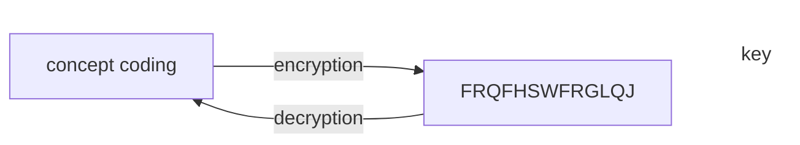
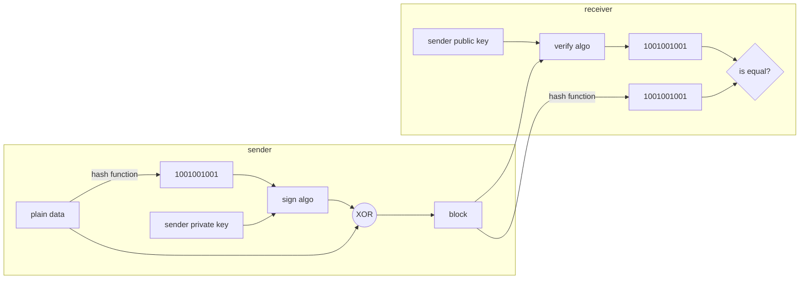

# Encryption

- It's a process of converting readable data into text which is difficult to understand.
- it make use of cryptographic key. consider it as a mathematical value which encryption method uses to convert the readable text into unreadable format.

# Types of encryption

## 1. symmetric encryption

- same key is used for both encryption and decryption
- Encryption and decryption algorithms
  - DES(Not Recommended)
    - fixed key length: 56 bits
    - process data in 64 bits
    - perform 16 rounds in its encryption process
  - AES
    - support key length: 128, 192 or 256 bits
    - process data in 128 bits
    - encryption round depends on key size:
      - 10 rounds - 128 bits key
      - 12 rounds - 192 bits key
      - 14 rounds - 256 bits key
- Advantages:
  - Fast and less computation compared to asymmetric
  - good for encrypting bulk data
- Disadvantages
  - key distribution i.e. how to securely distribute the key between clients and server
  - Number of symmetric keys and its distribution too

## 2. Asymmetric encryption

- uses 2 different keys i.e. private and public key
  - public key is used by sender to encrypt
  - private key is used by receiver to decrypt
- Encryption and decryption algorithms:
  - RSA
  - DSA
  - Diffe-hellman
  - ECDHE
- Advantages:
  - No security issues with the distribution as each user has a secret private key which they do not forward
  - provide key exchange algorithms like diffie-hellman
  - Digital signatures can be created using asymmetric encryption , help to authenticate and provide integrity too.
- Disadvantages:
  - computation intensive compared to symmetric encryption
  - might not suitable for encrypting bulk data as its little slow as compared to symmetric

# Digital signatures

Digital signatures are used for authentication and integrity of data

---

# Related

[[OAuth 2.0]]

---

# References / Sources

