# Database Indexing?

Few things we have to understand first, before we see how indexing works.

1. How table data (rows) are actually stored?
2. What type of indexing present?
3. understanding the data structure used for indexing and how it works?

# How table data is actually stored?

Table is just a logical representation this is not how the data is stored in the database, this is not the physical representation

- DBMS creates **Data Pages** (generally its 8KB but depends upon DB to DB)
- Each data page can store multiple table rows in it

## structure of data page

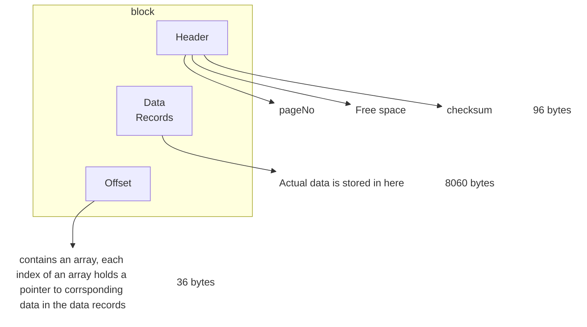

so if 1 table is lets say 64 bytes, so in 1 data page we can have ~ 125 DB rows

| Emp ID | Name | Address |
| ------ | ---- | ------- |
| 1      | A    | City A  |
| 2      | B    | City B  |
| 3      | C    | City C  |
| 4      | D    | City D  |

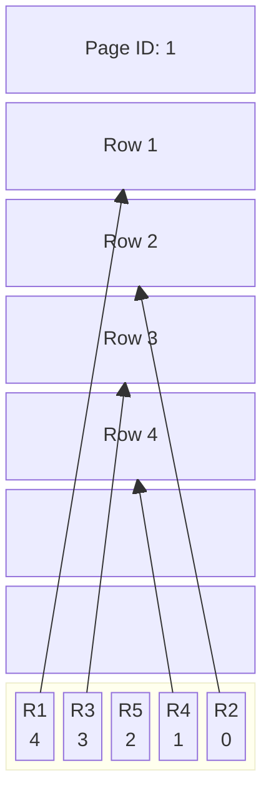

DBMS creates and manage these data pages. As for storing 1 table data, it can create many data pages
These data pages ultimately gets stored in the Data block in **Physical memory** like disk.

## What is Data block?

- Data block is the minimum amount of data which can be read/ write by an IO operation.
- It is managed by underlying storage system like disk, Data block size can range from _4 kb_ to _32 kb_ (common size is _8 kb_)
- so based on the data block size, it can hold 1 or many data page.

DBMS **mapping** the mapping of Data pages and Data Blocks

| Data Page 1 | Data Block 1 |
| ----------- | ------------ |
| Data Page 2 | Data Block 1 |
| Data Page 3 | Data Block 2 |
| Data Page 4 | Data Block 2 |
Remember, DBMS controls Data pages (like what row goes in which page or sequence of pages etc.) but has no control on Data blocks (data blocks can be scattered over the disk)

# Indexing in RDBMS

## Indexing?

It is used to increase the performance of the database query. so that data can be fetched faster.
without indexing, DBMS has to iterate each and every table row to find the requested data.
i.e. _O(N)_, if there are millions of rows, query can take some time to fetch the data.

### Which DS provides better time complexity then O(N)

B+ Tree, It provides _O(Log N)_ time complexity for insertion, searching & deletion.

### How B(Balanced) Trees work?

- it maintains sorted data
- All leaf are at the same level
- M order B tree means, each node can have at most M childrens
- And M-1 keys per node and M pointers which points to M childrens so a total of _2M-1_ entries

#### Example

Lets store the data in 3 order b tree: _9, 33, 75, 41, 98, 214, 126, 55,72_

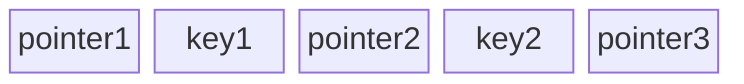

- pointer1 < key1
- pointer2 >= key1 & < key2
- pointer3 >= key2

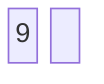

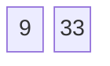

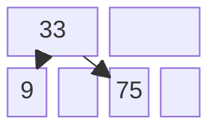

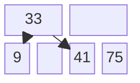

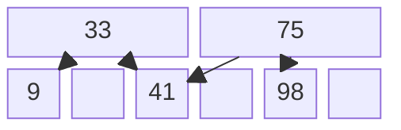

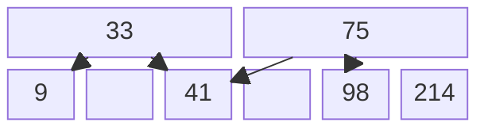

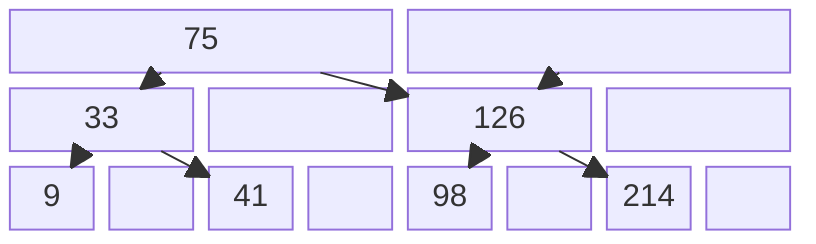

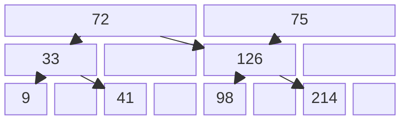

> [!info]
> B+ Trees are similar to B trees, the difference is only the child nodes are also linked together in B+ trees

**DBMS uses B+ trees to manage its Data pages and rows within that pages**
Root node or intermediary node hold the value which is used for faster searching the data. Possible that value might have deleted from DB, but it can be used for sorting the tree.
Leaf node actually holds the indexed column value.

| Emp ID | Emp Name |
| ------ | -------- |
| 19     | e1       |
| 25     | e2       |
| 30     | e3       |
| 17     | e4       |
| 6      | e5       |
| 1      | e6       |
| 5      | e7       |
3 order b tree will look like, for Emp ID to be indexed column

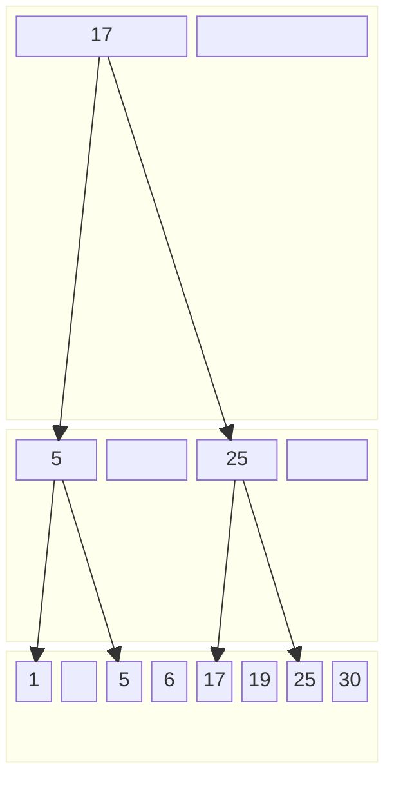

> [!warning]
> The bottom of the B tree contains the indexed data, the intermediary nodes contain stale data used for b tree construction that is why the indexed node are duplicated intentionally at the leaf level, the intermediary nodes are just for fast searching they will not be updated or deleted as with the data, the leaf node is only updated or deleted

# Type of Indexing

1. Clustered indexing
2. Non Clustered indexing

## Clustered Indexing

Order of rows inside the data pages. match with the order of the index

| Emp ID | Name | Address |
| ------ | ---- | ------- |
| 1      | A    | City A  |
| 4      | B    | City B  |
| 5      | C    | City C  |
| 2      | D    | City D  |
Let Emp ID be the primary key and put index over emp id

| EmpID index |
| ----------- |
| 1           |
| 2           |
| 4           |
| 5           |

---

# Related

[[Transaction Handling in Distributed systems|transaction]]
[[SQL vs NoSQL]]

---

# References / Sources

