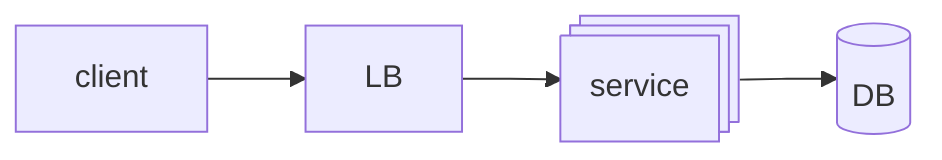
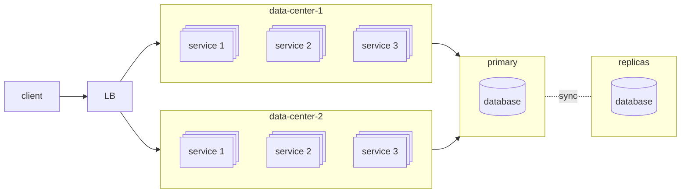
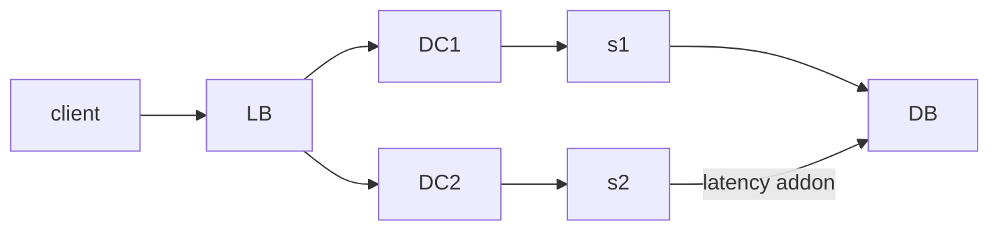
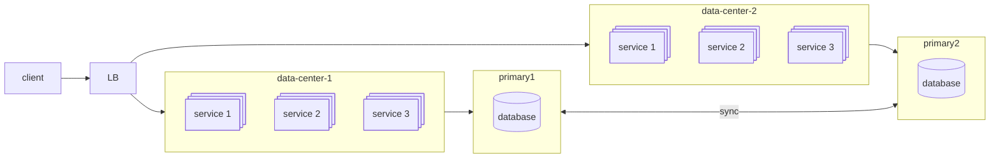

# It can be asked in many other forms like:

- Design Data Resiliency Architecture
- Design Architecture to achieve 99.999% Availability
- Design to avoid **Single Point of failure**
- Active-Passive vs Active-Active architecture
- Etc

# Single node case

It has a single point of failure, If it fails it might take hours to come over the failure so it is not data resilient

# Multi node case

## Active-Active Artitecture

**Why we cannot use the secondary DB?**
Oracle/ MySQL/ Postgres are not multi master. Whenever any write request comes these DBs can write them to live DB/ primary DB
But Reading can happen from replica nodes, which can be a better architecture

**What happens when primary DB goes down?**
We move our all traffic to Disaster recovery data center and make the replica DB layer as primary DB layer
as the live DB layer recover from failure we make it the replica DB layer

**Drawbacks**
Latency Addon

Delay when DB failure occur when shifting from Live to replicas
Cannot handle more traffic when compared to Active-Active Architecture

## Active Active Architecture

NoSQL DBs like MongoDB and Cassandra are multi-master and can write to multiple live DBs

**Complexity**
The sync part is the most complex and a disadvantage of this architecture

- change can happen to same row at same time so conflict on sync
- read from one and write at one at same time, so read is wrong

**Advantage**
We are totally utilizing are resources well, so we can handle more traffic for sure

# Related

[[Scale from 0 to 1M users]]
