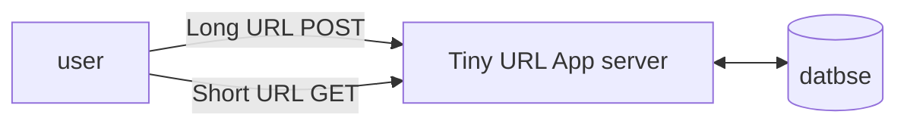

## What is URL shortener?



---

## Requirement Analysis

1. How short our URL should be? As much short as we can
2. Traffic per day? 10M URL/day = 3650 URL/year, for 100yrs we need 365B URLs
3. characters we can use? a-z, A-Z, 0-9 = 62 chars

---

## Calculations

$62^7 = 365 Billion$

we need at max 7 chars or 7 length output hash value to support 365B URLs

---

## Generating Hash value

1. Hash function

   1. MD5 (128-bit/16-bytes/32-hexa-digits): 32 char length
   2. SHA1(160bit): 40 char length

   We do not use hash function as we need to trim out extra char generation to 7 which can lead to duplicates outputs

2. Base 62 encoding

   we have 10 digits + 26 lowercase letters + 26 uppercase letters, resulting in a total of 62 characters.

   ```JavaScript
   // Base62 encoding function
   function encodeBase62(num) {
     const chars = '0123456789ABCDEFGHIJKLMNOPQRSTUVWXYZabcdefghijklmnopqrstuvwxyz';
     let encoded = '';
     while (num > 0) {
         const remainder = num % 62;
         encoded = chars[remainder] + encoded; // Prepend the character
         num = Math.floor(num / 62); // Divide the number by 62
     }
     return encoded || '0'; // Return '0' if the number is 0
   }

   // Base62 decoding function
   function decodeBase62(encoded) {
     const chars = '0123456789ABCDEFGHIJKLMNOPQRSTUVWXYZabcdefghijklmnopqrstuvwxyz';
     let decoded = 0;
     for (let i = 0; i < encoded.length; i++) {
         const character = encoded.charAt(i);
         const index = chars.indexOf(character); // Find the index of the character
         decoded = decoded * 62 + index; // Update the decoded number
     }
     return decoded; // Return the decoded number
   }
   ```

   ### Steps:

   1. ID generator
      1. Single database
         - Db capacity should be huge
         - single point of failure
         - Not suited for scaling
         - Auto increasing ID

      2. Ticket server

         - suited for scaling
         - single point of failure

         ```mermaid
         flowchart TD
         	db[(database)]
         	ts(Ticket server)
         	A1 & A2 & A3 --> ts --> db
         ```

      3. Snowflake
         - Timestamp approach

      4. Zookeeper

         - It is an application which helps different services in a distributed services coordinate with each other reliable
         - Helps us generating unique id in distributed env

         ```mermaid
         flowchart LR
         	A1[App1]
         	A2[App2]
         	A3[App3]
         	subgraph zookeeper
         		range1(0-1M)
         		range2(1-2M)
         		rangen(x-356B)
         	end
         	A1 --> range1
         	A2 --> range2
         	A3 --> rangen
         ```

   2. Length could be different

      We use padding in case when output length is less than 7

      can it exceed 7? No at 7 length output the value will be ZZZZZZZ which is 365B in decimal so covers our 365B URL requirement without exceeding length of 7

---

## Design

## HLD

![[System/Assets/tnsy8cb6.bmp]]

## LLD

![[System/Assets/v2u2doup.bmp]]

# Related

[[Scale from 0 to 1M users|scale]]
[[Back of the Envelop Estimation|BOE]]
