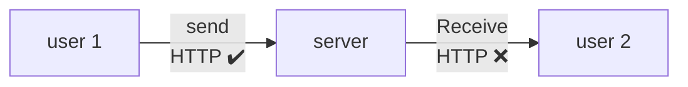

# Requirements

### Functional (MVP feat)

1. one-to-one Send/Receive message
2. Group message support
3. Last seen/ online offline
4. User login and authentication

### Non Functional

1. Scalability
2. Low latency
3. Availability

---

# Back of the Envelop

- Total users = 2B
- DAU = 50M
- 1 user can send 10 msg to 4 people in 1 day
- Total messages per day = 50M users X 40msg = 2B msg
- 1 msg = 100 chars = 100 bytes i.e. 2B msg/day = 200GB/day
- for 10years of chat history = 200GB X 365 X 10

---

# HLD



### Enhancing HTTP

1. Polling

   Wastage of resource and generally not scalable

   ```mermaid
   sequenceDiagram
       participant Client
       participant Server

       Note over Client,Server: Polling Mechanism
       loop Every few seconds
           Client->>Server: HTTP Request (poll for data)
           Server-->>Client: HTTP Response (data or empty)
       end
       Note over Client,Server: Each poll starts a new HTTP request
   ```

2. Long Polling (Pushing)

   Wait for a threshold before closing the req of client

   ```mermaid
   sequenceDiagram
       participant Client
       participant Server

       Note over Client,Server: Long Polling Mechanism
       Client->>Server: HTTP Request (wait for data)
       alt Data Available
           Server-->>Client: HTTP Response (data)
           Client->>Server: New HTTP Request (after receiving response)
       else Timeout
           Server-->>Client: HTTP Response (timeout)
           Client->>Server: New HTTP Request (reconnect immediately)
       end
   ```

3. WebSocket (HTTP upgrade)

   Bi directional persistant connection, it will only close when client goes off

   ```mermaid
   sequenceDiagram
       participant Client
       participant Server

       Note over Client,Server: WebSocket Connection
       Client->>Server: HTTP Request (Upgrade to WebSocket)
       Server-->>Client: HTTP 101 Switching Protocols
       Note over Client,Server: Persistent Connection Established
       loop Real-time Communication
           Client->>Server: Send Message
           Server-->>Client: Send Message
       end
   ```

### Overview


### One On One Chat

\--- start-multi-column: ID\_byyk

```column-settings
Number of Columns: 2
Largest Column: standard
```

#### Happy Flow

\--- column-break ---

#### Unhappy Flow

\--- end-multi-column

# Related

[[CAP Theorem|CAP]]
[[Back of the Envelop Estimation|BOE]]
[[SQL vs NoSQL]]
[[Caching Invalidation]]
[[Scale from 0 to 1M users|scale]]
