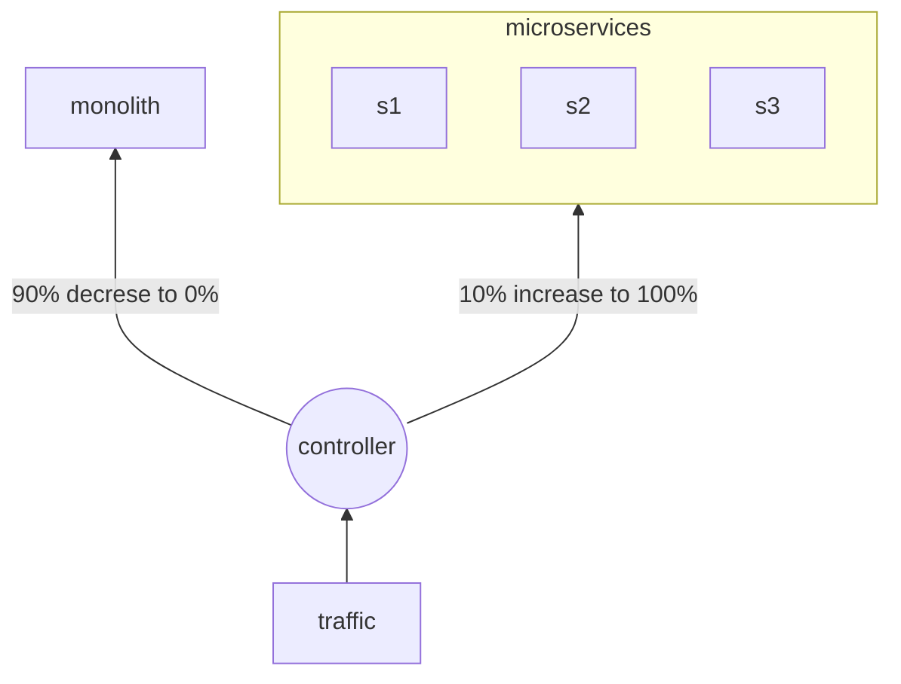
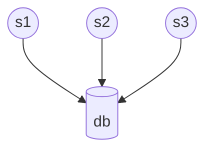
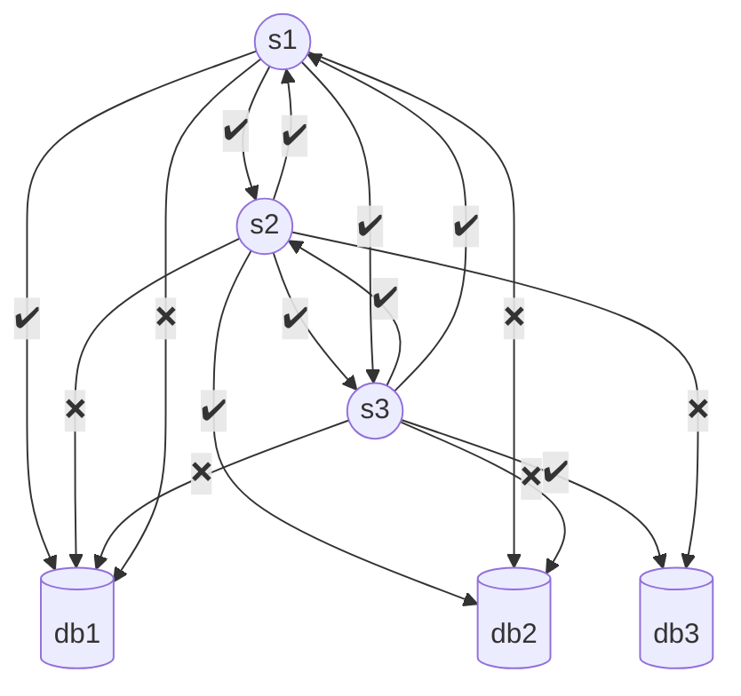

# Strangler



---

# Data Management

![[System/Assets/nost91ez.bmp]]

The main **principle** of **microservices data management** is that each microservices should manage **its own data,** we can call this principle as a **database-per-service**
\--- start-multi-column: ID\_6sib

```column-settings
Number of Columns: 2
Largest Column: standard
```

### Shared Database



Challenges:

- Database scaling is service independent
- Database type is fixed and cannot be modified wrt to different services available

Advantage

- Joining queries
- Transaction management

\--- column-break ---

### Database Per Service



Challenges:

- Joining Queries: CQRS
- Transaction management: SAGA

Advantage

- Scaling becomes service dependent
- Flexibility in choosing multiple databases for different services

\--- end-multi-column

## CQRS

> Command Query Request Segregation

Segregate Command i.e. Create Update Delete from Read operation, by using a common or shared database and query service which updates itself using EDA

![[System/Assets/y0rms9rt.bmp]]

## SAGA

> Sequencing of Transaction

\--- start-multi-column: ID\_cpv6

```column-settings
Number of Columns: 2
Largest Column: standard
```

### Choreographic

![[System/Assets/ueslfuvf.bmp]]

\--- column-break ---

### Orchrestration

![[System/Assets/9q28e4d8.bmp]]

\--- end-multi-column

# Resources

[[Monolith vs Microservices]]
