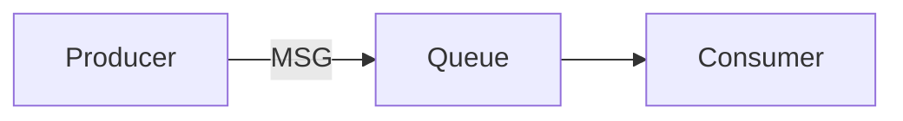
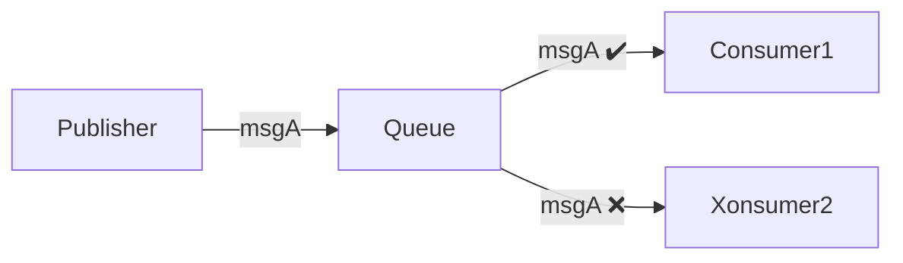
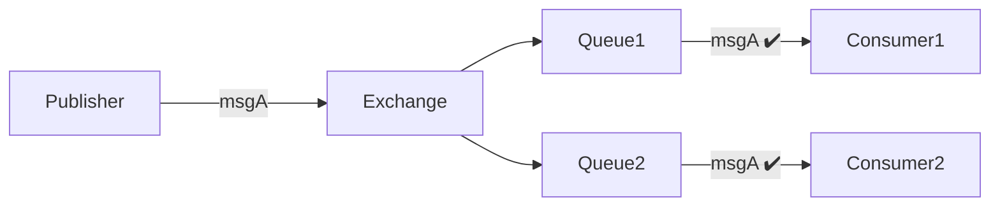
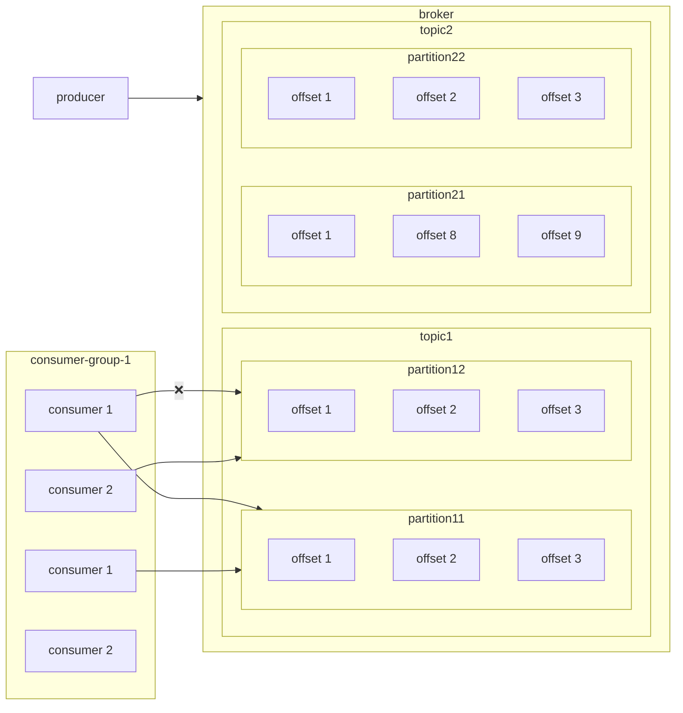
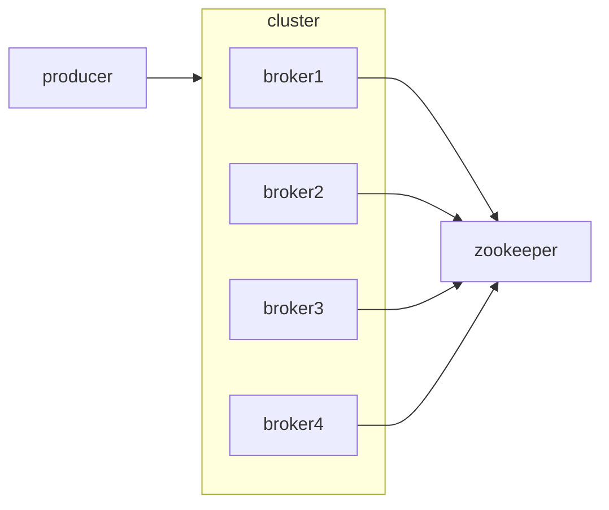
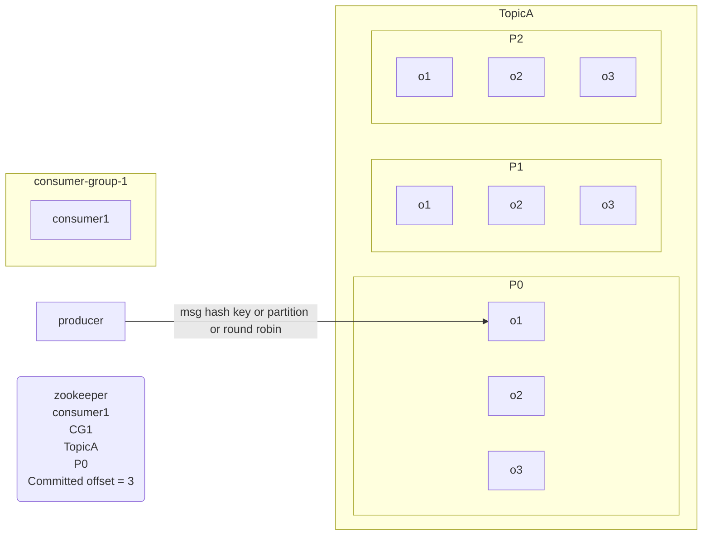
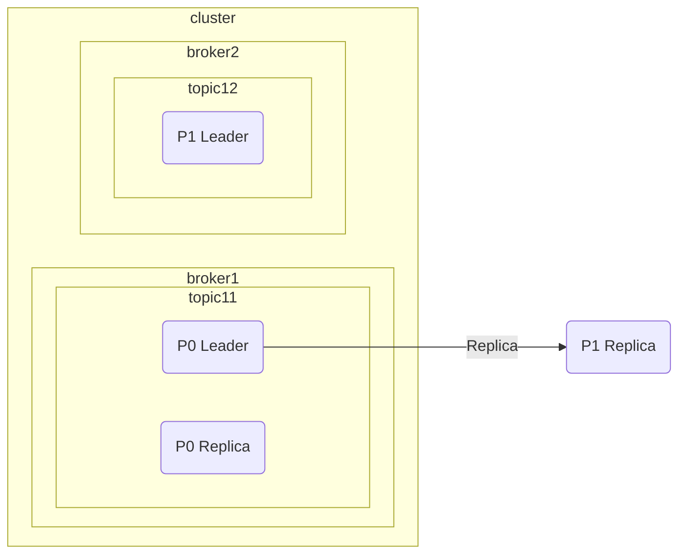
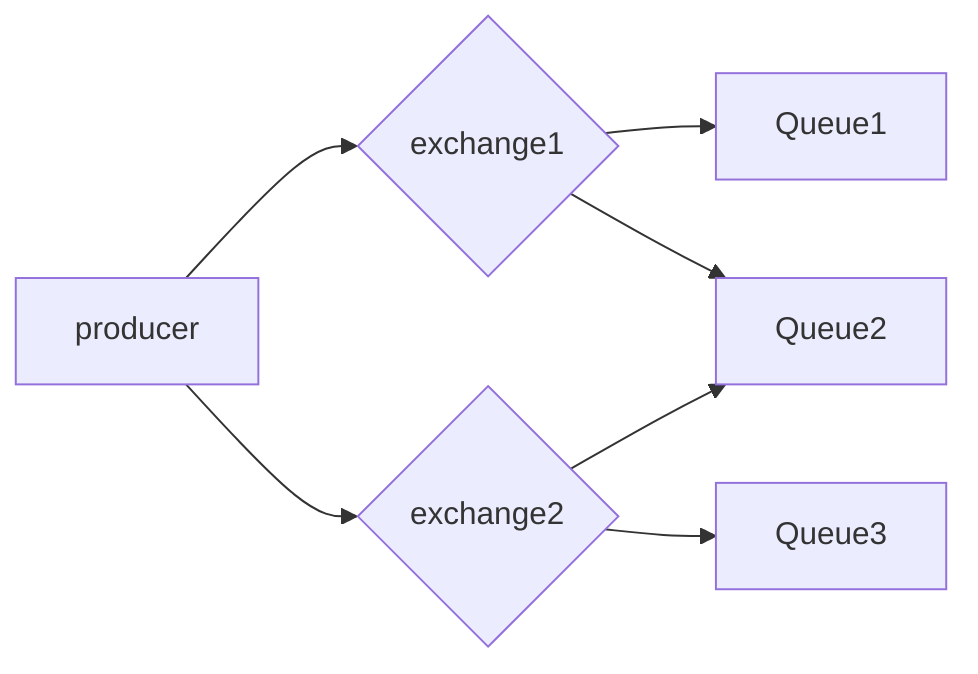

# Interview Questions Based on Messaging Queues

1. What is messaging queue? why its needed and its advantages?
2. what is the difference **Pub/Sub** and **point to point** messaging queues?
3. How messaging queues work? **Kafka** and **Rabbit MQ**
4. What happens when queue size limit is reached?
5. What happens to messages when queue goes down
6. What happens when consumer goes down?
7. What happens when consumer not able to process message?
8. How **Retry** works? Different ways to retry?
9. How Distributed Messaging Queues works?
10. What is **Dead Letter Queue** ?

# Messaging Queues And Why it is needed?




## USAGE

- **Asynchronous nature** -> latency gets reduced
- Producer can send message directly to consumer? **No Retry Capability** Messaging queues bring Retry capability, when consumers unable to consume message, it put it back in the queue

# Point To Point VS PubSub

### P2P

Message can be consumed by only 1 consumer



## PubSub

Message can be consumed by multiple consumers



# Message Queues Working

---

## KAFKA

> Kafka is Pull based approach

**Components**

1. Producer
2. Consumer
3. Consumer Groups
4. Topic
5. Partition
6. Offset
7. Broker(Kafka server)
8. Cluster
9. Zookeeper

**Architecture**





**Working**

```bash
msg = {
	key?: "id",
	value: "msg",
	partition?: "partition1",
	topic: "topic name"
}
```



if Consumer 1 goes down then zookeeper will pick another consumer from the same consumer group and it will start consuming data from the committed offset where the previous consumer left reading

**Distributed system case**



---

## RabbitMQ

> RabbitMQ is Pull based approach



**Fanout** -> It will push the message to all the queues related to a message
**Direct Exchange** -> Routing key is defined for msg schema and queue
**Topic Exchange** -> wildcard matching to push a msg to specific queue
**Consumer Fails** -> it put backs in the queue back for retry when retry exceeds it puts in the dead letter queue
