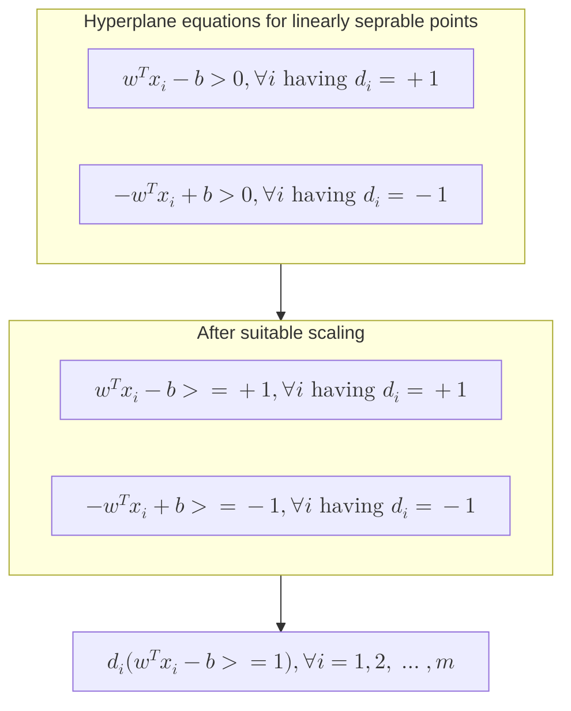

# Hard Margin Classifier

Let $\{ x_{i}\epsilon \mathbb{R}^{n}, i=1,2,\dots,m \}$ be set of finite patterns which is linearly separable having class of label +1 and -1. $d_{i}\epsilon \{ -1, +1 \}$ = target value of $i^{th}$ data.
Therefore, there exists $w\epsilon \mathbb{R}^{n}$ and $b\epsilon \mathbb{R}$ such that



- Among all the separable hyperplane we choose the hyperplane $w^{T}x=b$ for which the margin $\frac{2}{||w||}$ is maximum or $\frac{||w||^{2}}{2}$ is minimum
- To find the maximum margin classifier, the optimization problem can be modelled as
  $(P_{1}) \space min_{w,b} \frac{1}{2}w^{T}w \text{ s/t } d_{i}(w^{T}x_{i}-b)\geq 1, i=1,2,\dots,m$
- This is a **CPP** with m constraints
- using Lagrangian duality to solve the above equation we reduce the number of constraints
  $L(w,b,\alpha_{i})=\frac{1}{2}w^{T}w+\sum_{i=1}^{m}\alpha_{i}(1-d_{i}(w^{T}x_{i}-b))=\frac{-1}{2}\sum_{i=1}^{m}\sum_{j=1}^{m}\alpha_{i}\alpha_{j}d_{i}d_{j}x_{i}^{T}x_{j}$
  KKT conditions and feasibility conditions for P1 are given as,
  $\nabla_{w}L=0\implies w=\sum_{i=1}^{m}\alpha_{i}d_{i}x_{i} \text{ and } \frac{\delta L}{\delta b}=0 \implies \sum_{i=1}^{m}\alpha_{i}d_{i}=0\text{ and }\alpha_{i}\geq 0 \text{ and }d_{i}(w^{T}x_{i}-b)\geq 1\implies\alpha_{i}[1-d_{i}(w^{T}x_{i}-b)]=0$
  Dual is given as,
  $(P_{2}) \space min_{w,b}L(w,b,\alpha) \text{ s/t KKT conditions of P1}$

---

# Follow up

```tabs
tab: Next Lectures
| File | created |
| ---- | ------- |

tab: Previous Lectures
| File                                                                                                          | created        |
| ------------------------------------------------------------------------------------------------------------- | -------------- |
| [[Resources/Joint probability distribution and covariance.md\|Joint probability distribution and covariance]] | April 18, 2025 |
| [[Resources/Continuous probability distributions.md\|Continuous probability distributions]]                   | April 18, 2025 |
| [[Resources/Discrete probability distributions.md\|Discrete probability distributions]]                       | April 18, 2025 |
| [[Resources/Expectation and Variance.md\|Expectation and Variance]]                                           | April 18, 2025 |
| [[Resources/Bayes' theorem and Random variables.md\|Bayes' theorem and Random variables]]                     | April 18, 2025 |

```

---

# References


