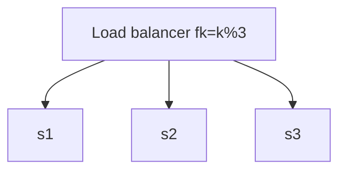
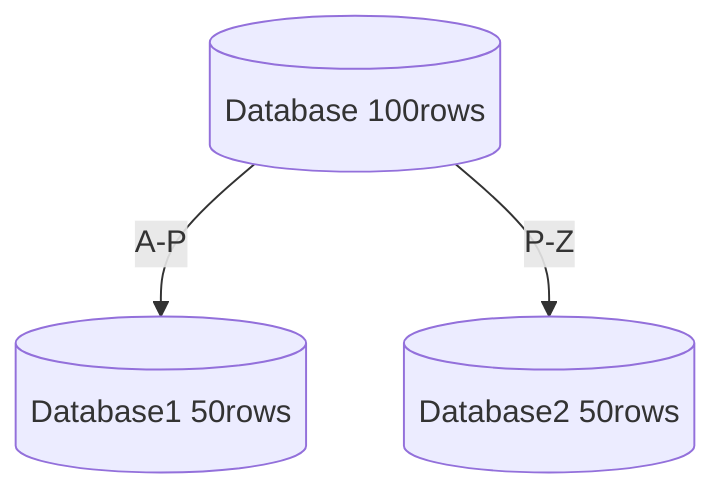

# Hashing

> Arbitrary length key is passed through a hash function and generates a fixed length output

![[System/Assets/nve07fw6.bmp]]

## Problem with hashing

> Clustering and Dynamic hash function

Earlier req of Krishna was served by db1, now on scaling up or down the req for krishna may not be served by same database node in which his information is stored as the load balancer mod hash function changes as

$f(k) = k \% n$

where n is the number of nodes it needs to balance load, so the currently serving node needs to request krishna’s data from the one having it, this is known as **Rebalancing**

We need to rebalance millions of keys when using normal hashing

## Hashing in Distributed systems

1. Load balancing for application server

2. Horizontal partitioning/ sharding

---

# Consistent Hashing

> It solves the problem of Dynamic hash function by reducing rebalancing to

$1/n \% (keys)$

## Working

![[System/Assets/q289wjla.bmp]]

The **clockwise traversal** of the ring corresponds to the increasing order of location addresses, so each request can be served by the server node that first appears while traversing clockwise.

![[System/Assets/j8n4q61v.bmp]]

Let’s say we have 5 nodes in the ring and say node 3 fails, then the range of the next server node widens and any request coming in all of this range, goes to the new server node. This shows that due to use of consistent hashing only a small portion of keys are affected

![[System/Assets/yfxld9f9.bmp]]

# Challenge

Clustering in Consistent hashing, We create **virtual objects**

Just create Duplicate server at different points within the ring so if 2 or 3 nodes cluster up they do not accumulate
