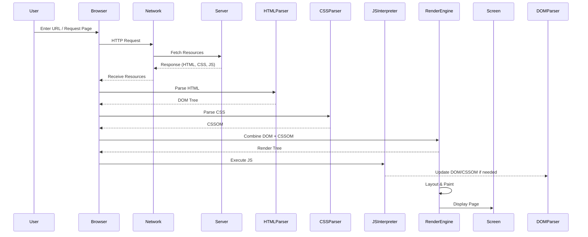

# Browser

# How Browser works?



---

# Follow up

```tabs
tab: Next Lectures
| File | created |
| ---- | ------- |

tab: Previous Lectures
| File                                                                        | created           |
| --------------------------------------------------------------------------- | ----------------- |
| [[Resources/Web servers and API gateways.md\|Web servers and API gateways]] | February 08, 2025 |
| [[Resources/Authentication.md\|Authentication]]                             | October 11, 2025  |
| [[Resources/API gateway.md\|API gateway]]                                   | February 19, 2025 |
| [[Resources/Thunder herd effect.md\|Thunder herd effect]]                   | February 19, 2025 |
| [[Resources/JWT.md\|JWT]]                                                   | February 19, 2025 |

```

---

# References


