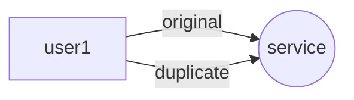
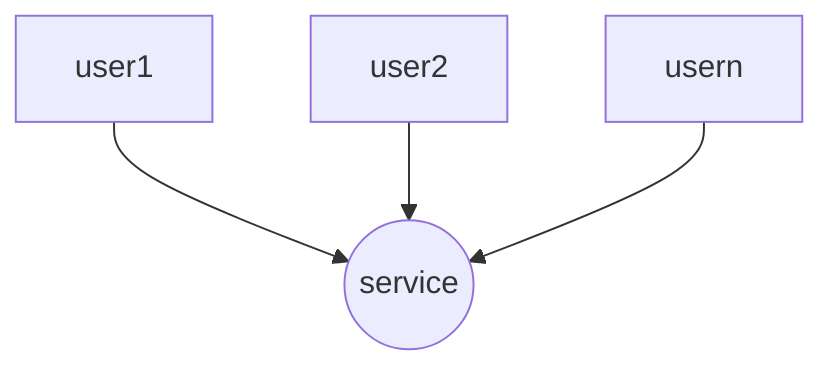
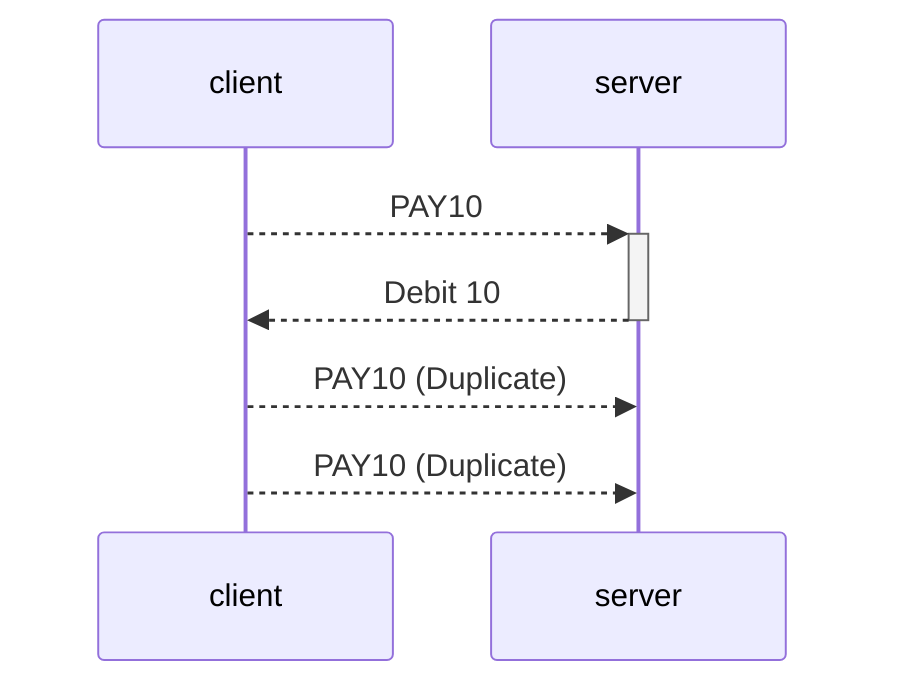
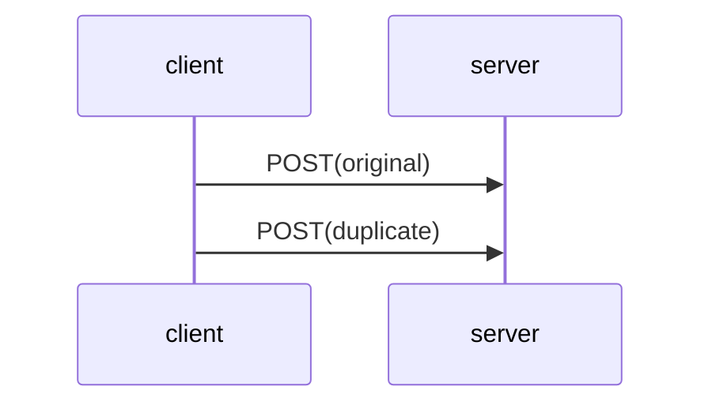
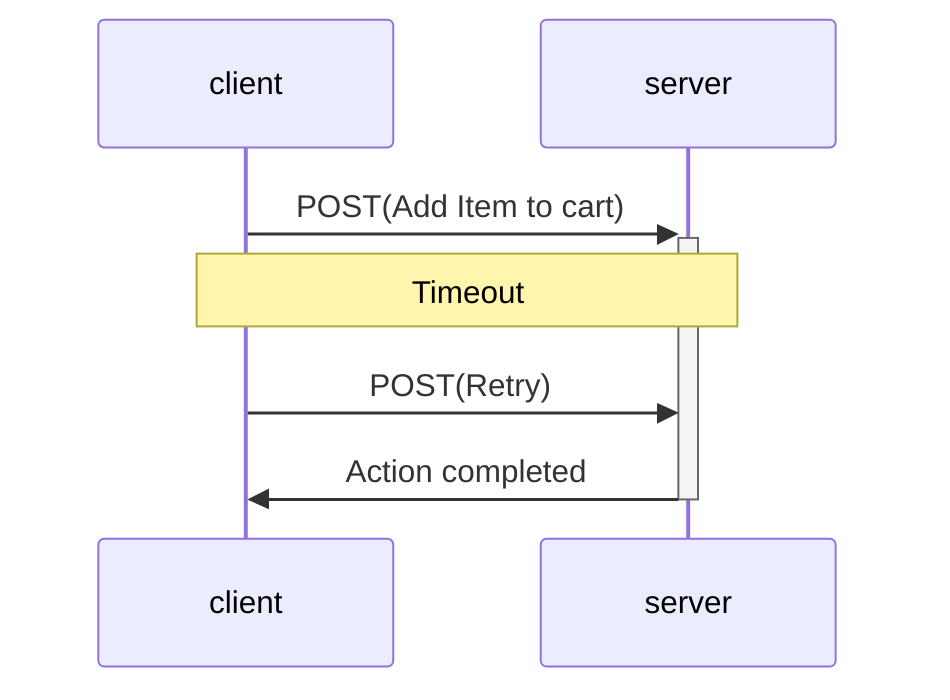
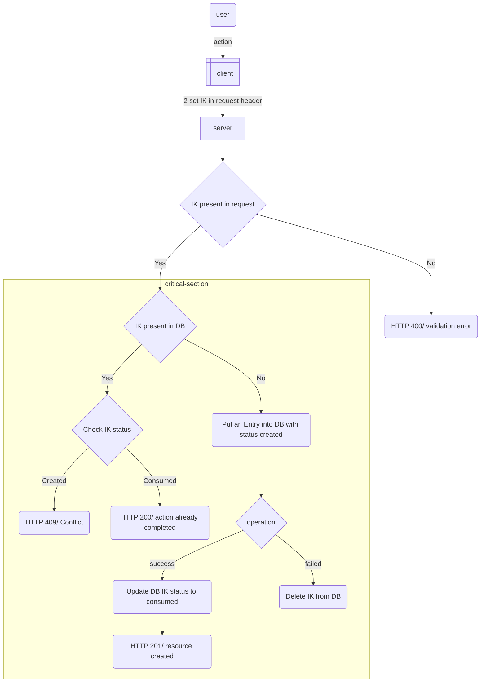
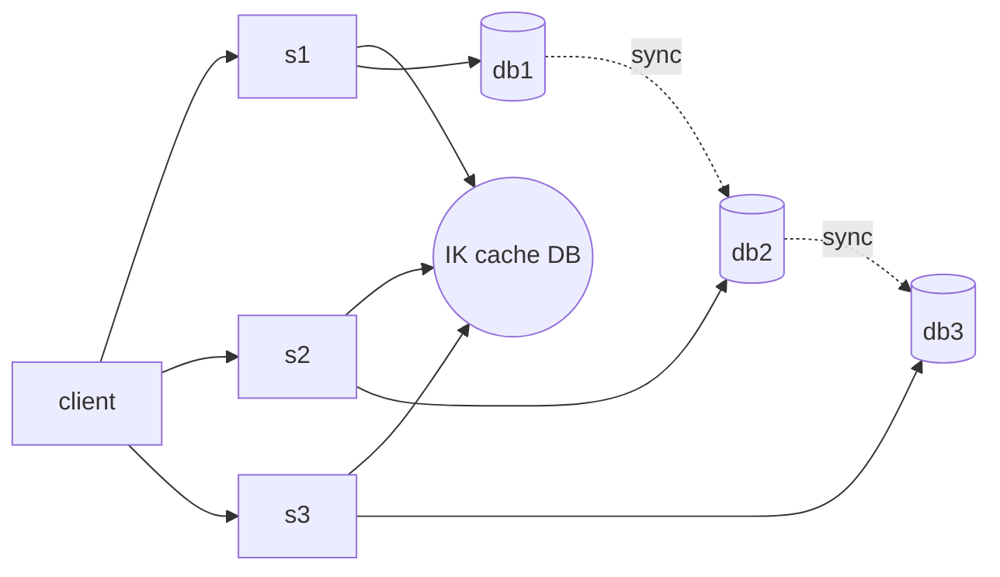

## Idempotency VS Concurrency

> [!Idempotency]
> Help us to take care of duplicate Request



> [!Concurrency]
> Accessing a service at a same time



## What is Idempotency?

> [!Defination]
> It enables client to safely **Retry** an operation without worrying about the side effect of operation can cause.

By default GET, PUT, DELETE methods are Idempotent in nature, but POST method is not Idempotent.



### Side Effects

> How duplicate can come?

\--- start-multi-column: ID\_0daj

```column-settings
Number of Columns: 2
Largest Column: standard
```

**Sequential**
Duplicate request occur due to original request timeout



\--- column-break ---

**Parallel**
Requests coming at the same time



\--- end-multi-column

## Approach for Idempotency Handling

> Using Idempotency Key??

> \[!Idempotency key]
> It is a Unique id UUID

Agreement with the client

1. Client should generate the IK
2. For each operation new TK should be generated

## Flow



### Follow up ques?

1. For parallel requests coming we utilize concept of critical section and mutual exclusion using some setx, mutex
2. In case of distributed service -> using caching


