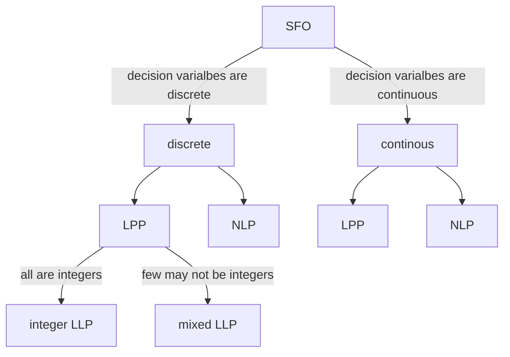

# Optimization

Optimization is the process of making the best use of a situation or resource. It is choosing the best element from set of alternatives according to some criterion.
**Mathematica programming problem**
A MPP is one that typically maximizes or minimizes a function (aka objective function) with respect to a set of criteria, called the Constraints

# Types of Optimization Models

## 1 ~ Single Objective Optimization models

**Functional Representation**
$max/min \space f:\mathbb{R}^{n}\to \mathbb{R}, x = (x_{1},x_{2},\dots,x_{n})^{T}, \text{ subject to } g_{j} \leq 0, j=1,2,\dots,m$
**Matrix Representation**
$max/min \space z = C^{T}X, \text{ subject to } AX\leq b$
**Decision Variables**
$x = (x_{1},x_{2},\dots,x_{n})\epsilon \mathbb{R}^{n}$
are called decision variables

- the formulation of an optimization problem begins with identifying the decision variables
- they relate the objective function and the constraints
- they can be continuous, discrete or sets.

**Objective Functions**
The function f is called the objective function, a criteria wrt which the decision variables are to be optimized

**Constraints**
the conditioni or set of conditions that the decision variables must satisfy are called constraints. these can be

- inequality constraints of the form g(x) <= 0
- equality constraints of the form h(x) = 0
- integer constraints of the for x belongs to I, where I is the set of integers

**Feasible set**
The set of variables that satisfies all constraints is called the feasible set or feasible region.
$S = \{ x\epsilon \mathbb{R}: g_{j} \leq 0, j=1,2,\dots,m \}$
A feasible region can be bounded or unbounded

- x hat belongs to S is called _feasible point_
- A feasible point which optimize our objective function is called _optimal point_
- if S = phi, then problem is infeasible
- if S = Rn then problem is _unconstrained optimisation_ otherwise it is called _constrained optimization_

### Types of Single function optimization problems

#### Linear programming problem

where the objective function and the constrains are both leanear fucntions of decision variables.

#### Non linear programming problems

where either the OF or the constrains or both are non linear functions of the decision variables



### Optimization Techniques

there are several optimization tech to solve an optimization problem

- _Math Programming tech_
  - simplex algo, interior point method
  - cutting plane algo, branch and bound method
- _Meta heuristic tech_
  - Generic algo
  - Particle swarm optimization
  - Grey wolf optimization
- _Numerical opetimization tech_
  - Steepest descent
  - Newtons method
  - conjugate gradient method
  - penalty function method

## 2 ~ Multi Objective Optimization models

$max/max \space f:\mathbb{R}^{n}\to \mathbb{R}^{m}, x=(x_{1},x_{2},\dots,x_{n})^{T}$
the optimal solution is called ideal solution and such solutions rarely occur as they are conflicting in nature
Hence we use a **Goal Programming Tech** where we assign weights to every function and convert the problem to single objective optimization problem

# Optimization Types

## Local

a point x = alpha is said to be local maxima of f if,
$\exists \delta > 0, f(\alpha)\geq f(x), \forall x\epsilon N_{\delta}(\alpha)$

## Global

a point x = beta is said to global maxima of f if,
$f(\beta)\geq f(x), \forall x\epsilon S$
----------------------------------------

# Follow up

```tabs
tab: Next Lectures
| File                                                                                        | created        |
| ------------------------------------------------------------------------------------------- | -------------- |
| [[Resources/Unconstrained Optimization.md\|Unconstrained Optimization]]                     | April 16, 2025 |
| [[Resources/Constrained Optimization-I.md\|Constrained Optimization-I]]                     | April 16, 2025 |
| [[Resources/Constrained Optimization-II.md\|Constrained Optimization-II]]                   | April 17, 2025 |
| [[Resources/Steepest Descent method.md\|Steepest Descent method]]                           | April 17, 2025 |
| [[Resources/Newton's and Penalty function method.md\|Newton's and Penalty function method]] | April 17, 2025 |

tab: Previous Lectures
| File                                                                                  | created        |
| ------------------------------------------------------------------------------------- | -------------- |
| [[Resources/Properties of Convex functions-II.md\|Properties of Convex functions-II]] | April 15, 2025 |
| [[Resources/Properties of convex functions-I.md\|Properties of convex functions-I]]   | April 10, 2025 |
| [[Resources/Convex Sets and Functions.md\|Convex Sets and Functions]]                 | April 10, 2025 |
| [[Resources/Basic Concepts of Calculus-V.md\|Basic Concepts of Calculus-V]]           | April 10, 2025 |
| [[Resources/Basic Concepts of Calculus-IV.md\|Basic Concepts of Calculus-IV]]         | April 09, 2025 |

```

---

# References


