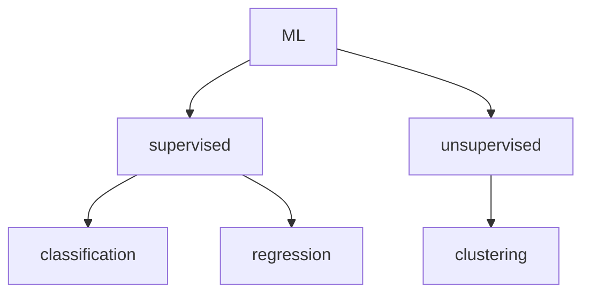

# ML

- The term ML basically deals with learning from the data which could be in the form of images, measurements, observations, patterns or records.
- The aim of any ML algorithm is to perform well on the training data and also to ensure good results in the future.
- ML involves the sturdy of three main problems: classification, clustering, and regression
- There are many approaches available in the literature to deal with these problems
- Mangassarian has introduced an approach called _Mathematical programming approach_. The advantage of using this method is that most of the models involved in ML result into LPP, QPP or CPP
- ML techniques are broadly classified as



- Vapnik has developed the SVM algorithm
- The main advt of SVM over other methods is that it results a CPP and hece we always obtain a global optimum solution, moreover KKT conditions become sufficient

# Binary Pattern classification

pattern means an element of $\mathbb{R}^{n}$. Let $m_{1}$ patterns having class of label $+1$ and $m_{2}$ patterns having class of label $-1$.
Let $[A^{+}]_{m_{1}\times n}$= The collection of $m_{1}$ patterns having class of label +1 and $[A^{-}]_{m_{2}\times n}$ = The collection of $m_{2}$ pattens having class of label -1

## Linearly Separable

Two sets $A^{+}$ and $A^{-}$ $\epsilon \mathbb{R}^{n}$ are said to be **linearly separable**, if there exists a hyperplane $w^{T}x=b, w\epsilon \mathbb{R}^{n}, b\epsilon \mathbb{R}$ such that $A^{+}w>eb$ and $A^{-}w<eb$. where, e = vector of ones
![[System/Assets/Pasted image 20250419230458.png]]

## Non Linearly Separable

if $A^{+}$ and $A^{-}$ are not linearly separable then they are called non linearly separable
![[System/Assets/Pasted image 20250419230939.png]]

## Method to justify linear separation of data points

### Method ~ 1

Let A and B be finite sets in $\mathbb{R}^{n}$. then A and B are linearly separable _iff their convex hulls are disjoint_

> [!abstract]
> The smallest convex set containing n points is the set formed by joining all the n points, or the figure in which those n points are vertices

convex hull is the smallest convex set containing the points from the set
if convex hull of two sets overlap they are not linearly separable
![[System/Assets/Pasted image 20250419231435.png]]
not linearly separable

### Method ~ 2

[[Error Minimizing LPP]]

---

# Related

---

# Follow up

```tabs
tab: Next Lectures
| File | created |
| ---- | ------- |

tab: Previous Lectures
| File                                                                                                          | created        |
| ------------------------------------------------------------------------------------------------------------- | -------------- |
| [[Resources/Joint probability distribution and covariance.md\|Joint probability distribution and covariance]] | April 18, 2025 |
| [[Resources/Continuous probability distributions.md\|Continuous probability distributions]]                   | April 18, 2025 |
| [[Resources/Discrete probability distributions.md\|Discrete probability distributions]]                       | April 18, 2025 |
| [[Resources/Expectation and Variance.md\|Expectation and Variance]]                                           | April 18, 2025 |
| [[Resources/Bayes' theorem and Random variables.md\|Bayes' theorem and Random variables]]                     | April 18, 2025 |

```

---

# References


