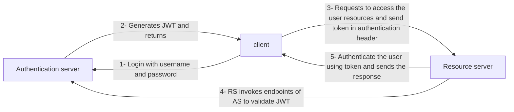
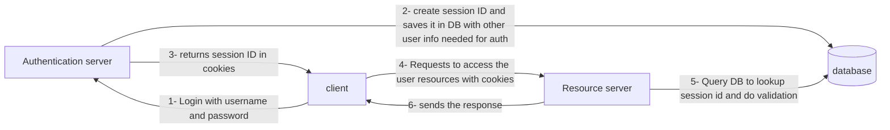
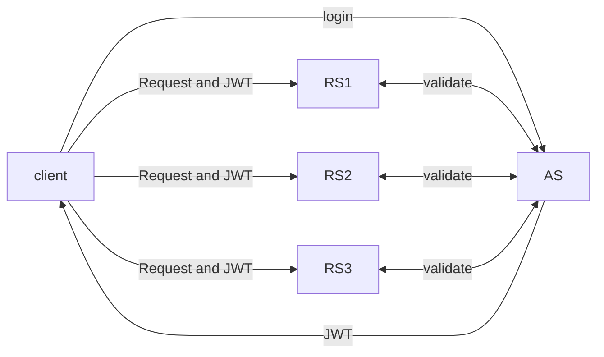

# What is JWT (JSON Web Token)

- it provides a secure way of transmitting information between parties as a json object
- This information can be verified because its digitally signed using RSA (public/ private key pair) etc.
- **Advantages**:
  - _Compact_-> because of its size, it can be sent inside HTTP header itself. and due to its size its transmission is fast
  - _self contained/ stateless:_ the payload contains all the required information about the user thus it avoid querying the database
  - can be signed using symmetric(HMAC) or Asymmetric(RSA)
  - built in expiry mechanism
  - custom claim(additional data) can be added in the JWT
- **Applications**:
  - Used for _Authenticating_ (confirming users identity)
  - Used for _Authorization_ (checks the user permission before providing access to resources)
  - Used for _SSO_ (Single sign on) i.e. authenticate once and access multiple applications



# History of JWT

Before we understand more about JWT, lets first understand, what was popular before JWT and what are the problems with it?

## Sessions (or JSessionID)



```json
{
	sessionID: "",
	expiryTime: "",
	userId: "",
	role: ""
}
```

**CONS**:

- stateful: It rely on server side management, it cause problem in distributed systems
- its just a unique random string, when server get this id, it has to perform DB query to fetch the details

# How JWT is stateless

JWT structure
$aaaaaaaaaa.bbbbbbbbbb.cccccccccc$
aaaaaaaaaa -> header
bbbbbbbbbb -> payload
cccccccccc -> signature

```json
header {
	"typ": "jwt",
	"alg": "RSA",
	"kid": "sfdf234234"
}
payload {
	"iss": "https://example.com/auth",
	"sub": 1234567890,
	"exp": 1711945909,
	"email": "conceptcoding@xyz.com",
	"jti": "unique_id_12312312"
}
signature: RSASHA256(Base64UrlEncode(Header) + "." + Ba)
```

#### Header

- contains metadata information of the token
- typ: type of algorithm, generally JWT always we add here
- alg: signing algorithm used like RSA or HMAC

#### Payload

- contains clains or in simple terms user information or any other additional information is kept here
- Types of claims
  1. Registered claims
  2. public claims
  3. private claims

##### Registered claims

Predefined names and meaning

- iss: issuer, entity that issues the JWT
- sub: subject, identifies the user
- aud: audience, identifies the reciptent for which token is intended
- exp: expiration time, after this time token is invalid
- nbf: not before, time before which token should not be accepted
- iat: issued at, time at which token is issued
- jti: JWT ID, unique id

##### Public claims

its a custom claim, which can be shared and understood by multiple parties like email, country, city, do not use like password

##### Private claims

its a custom claim, which are inteded for internal use only and not standarized, nor expected that other parties understand this

#### Signature (JWS- json web signature)

- encode jwt header and payload using base64 encoding
- concatenate the encoded header and payload strings using "."
- xxxxxxxxxx.yyyyyyyyyy is known as message
- use RSA(Asymmetric) or HMAC(symmetric) to create digital signature
- concatenate using "."

```http
GET "https://example.com/api/resource" --header Authorization: Bearer token
```

# SSO using JWT



# Challenges

1. token invalidation: lets say, i have blacklisted one user, how to invalidate its token before expiration?
   - server need to keep list of blacklisted tokens and then DB/cache lookup is required while vaildating
   - Or, change the secret key, but this will make JWT invalidate for all users
   - Or, token should be very short lived
   - Or, token should be used only once
2. JWT token is encoded not encrypted so its less secure
   - use JWE, Json web encryption
3. JWK exploit: public key shared in this, should not be used to verify the signature, e stands for "exponent" and "n" stands for "modules" and combined together they form public key.

```json
{
	"typ": "JWT",
	"alg": "RSA",
	"jwk": {
		"n": "",
		"e": "",
		"kid": ""
	}
}
```

---

# Related

[[Cryptography]]

---

# References / Sources


