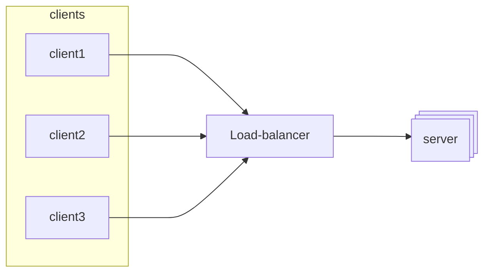
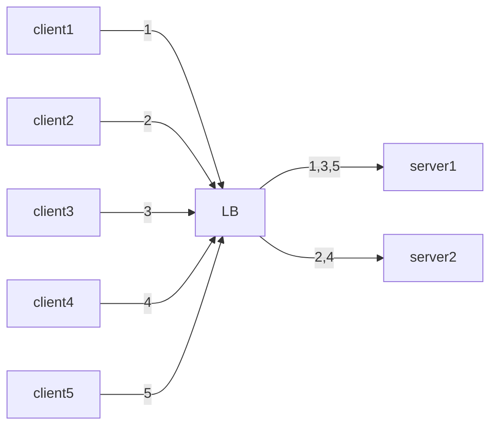
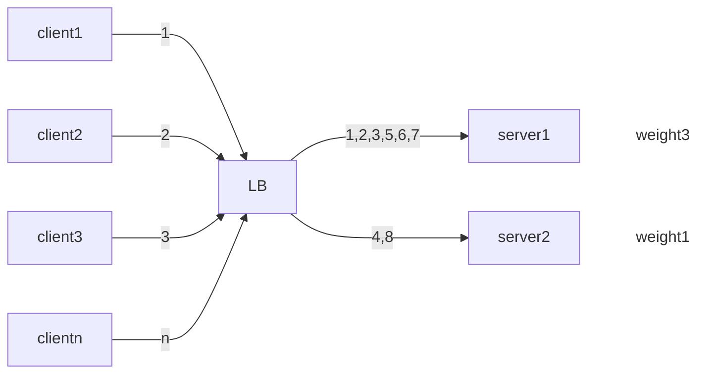
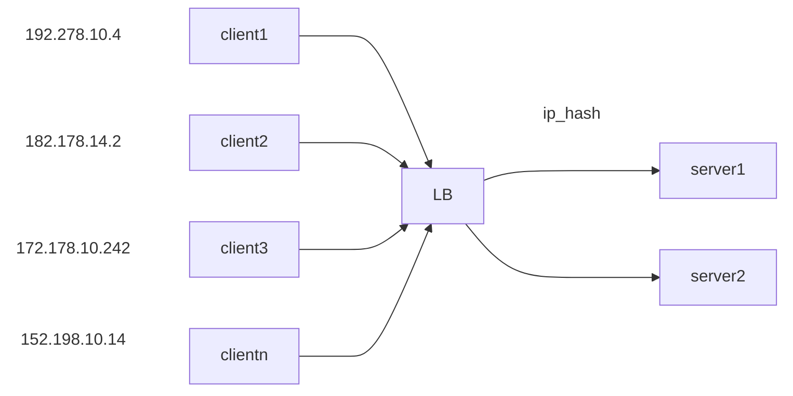
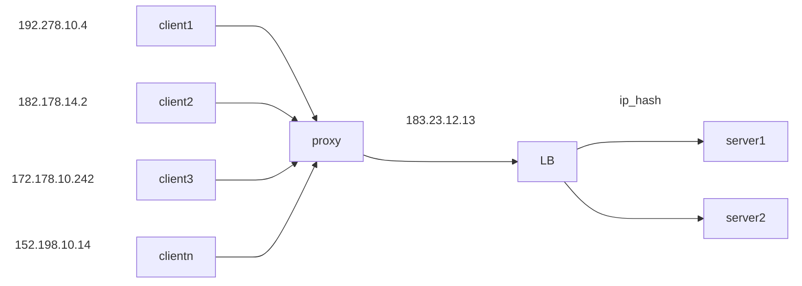
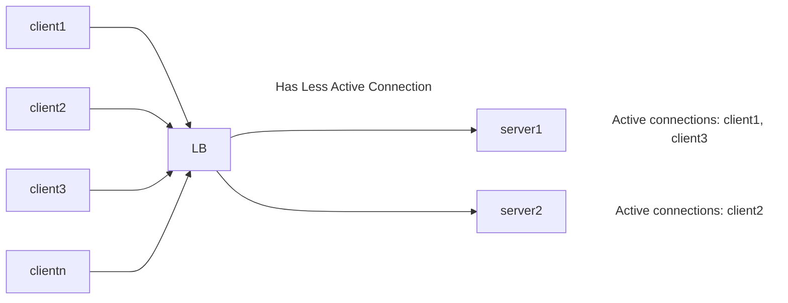
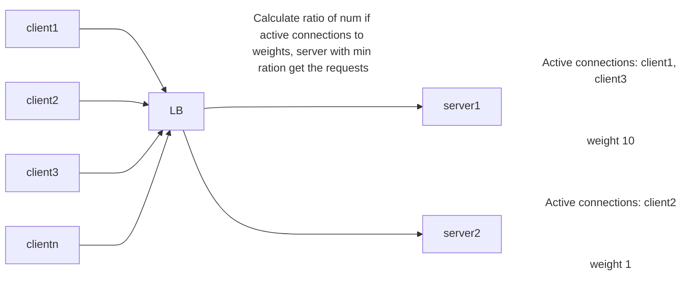
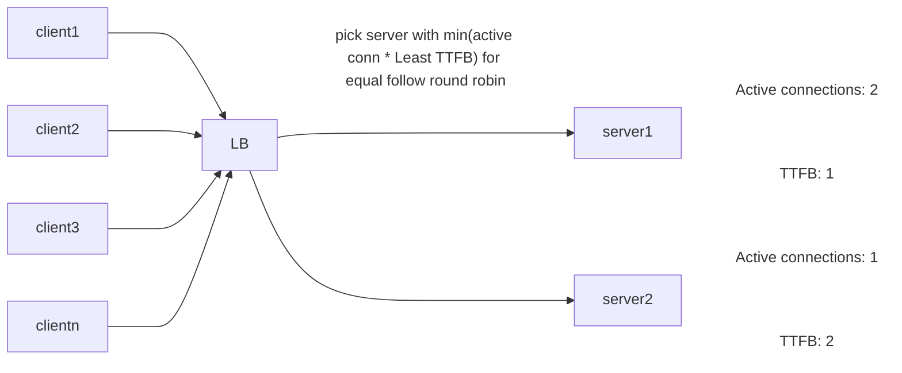

# Load Balancer?

# Types of Load balancer

## 1. Network Level Load balancer (L4 balancer)

It can read packets TCP port, UDP port, IP address of source and destination, based on this it routes or balance the request accordingly
It is much more faster than Application Load balancer

## 2. Application Level Load Balancer (L7 balancer)

It can take decision to distribute traffic based upon Header/ session/ cookies/ data. It can also perform caching. It is much more advanced

---

# Load balancing Algorithms

## 1. Static Algorithms

### Round robin

#### Advantages

- Very Easy to implement
- Equal load balancing distribution

#### Disadvantages

- one server with high capacity and one with low will be treated as equal
- chance that low capacity server will go down is high

### Weighted Round robin

it tries to solve the drawback of round robin by giving wights to the server acc to resources

#### Advantages

- Low capacity server will get saved from receiving the large num of requests
- easy to implement as weights are static, no dynamic computation

#### Disadvantages

- If requests have different processing time, it is possible that low capacity server might get high processing requests, and possible it might get exhausted soon

### IP HASH

#### Advantage

- Good for use cases, where same client need to connect to same server
- easy to implement

#### Disadvantage

- If client request is coming through **PROXY** then all the client will be assigned the same server which might create overload
- cannot ensure equal distribution

## 2. Dynamic Algorithms

### Least connection

#### Advantages

- dynamic, as it considers the load on each server, so chance of over burden of the server is less when each server has equal capacity

#### Disadvantages

- TCP connections can be active but possible have no traffic (requests)
- unable to differenciate BW low capacity and high capacity server. chance that low capacity server will get over burdened.

### Weighted Least connection

### Least response time

**TTFB** -> Time to first byte i.e. time interval BW sending a request and receiving response from the server, it is computed dynamically

---

# Related

---

# References / Sources

