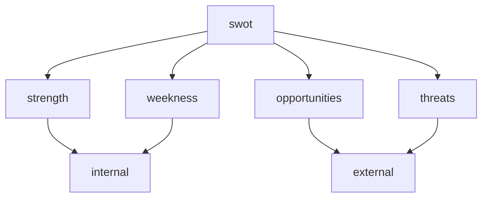
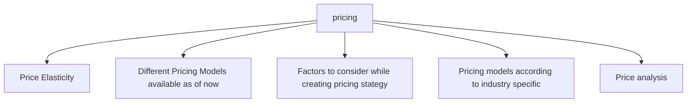
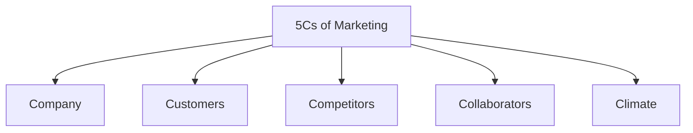
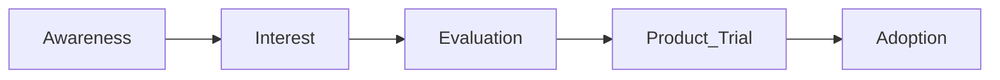
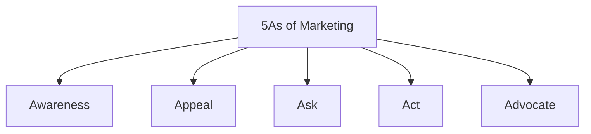
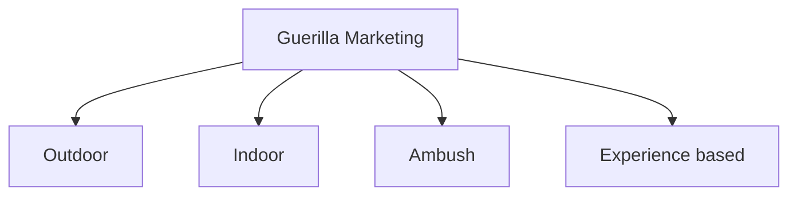

# Marketing

The action or business of promoting and selling products or services, including product understanding / market research and advertising.
Tool or Medium for Marketing is Digital Marketing.

# Digital Marketing

- **Strategic Implementation**: Finding your target group
- **Technical Implementation**: Defining Google Ads Conversion

# Marketing Concept

1. Product Differentiation
2. Quality Differentiation → Apple
3. Price Differentiation → PW

# 7Ps of Marketing (Pillars Of Marketing)

## Product

1. Product
2. Price
3. Place
4. Promotion

## Service

1. Product
2. Price
3. Place
4. Promotion
5. People
6. Process
7. Physical Evidence

# SWOT Analysis / Metrics

$$$Swot = \begin{bmatrix}
S & W \\
O & T
\end{bmatrix}$$

> [!Note]
> Swot Analysis is Done before Marketing Strategy

Swot Analysis is done on different levels:
- Org Level
- Project Level
# Pricing Models / Pricing Strategies

## Price Elasticity of demand

Price Elasticity measures how sensitive the demand and supply of your product are to changes in price.
$$PED = \frac{\text{Percentage change in quantity}}{\text{percentage change in price}}$$
Fuel is price inelastic product while movie ticket is price elastic product.
## Different Pricing Models

| Model             | Strategy                                                                                      | Example                     |
| ----------------- | --------------------------------------------------------------------------------------------- | --------------------------- |
| Skimming          | Start with high price and then slowly decrease with price                                     | Mobile                      |
| Penetration       | Entering into market with low price                                                           | High price sensitive market |
| Value Based       | Based on true value of product                                                                |                             |
| Dynamic           | Flexible, can change easily                                                                   | SAAS                        |
| Competetion Based | For Highly competitive products, when those types of products are already available in market |                             |
| Psychological     | Rs 99 or Rs 1099                                                                              |                             |
| Premium           | When the products are of high luxury                                                          | 5 star hotels / Iphone      |
# Sales and Marketing
$$\text{Sales}\subset \text{Marketing}\subset \text{Organisation}$$

| Parameters | Marketing                     | Sales                       |
| ---------- | ----------------------------- | --------------------------- |
| Focus      | Promotion and brand awareness | Fulfill the sales & targets |
| Strategy   | Pull                          | Push                        |
| Duration   | Long term                     | Short term                  |
| Target     | A large base                  | Individual or small crowd   |
| End Point  | Audience attraction           | Selling of a product        |
# Product Life cycle
A product goes from the time it is introduced in the market til it leaves the market

![[System/Assets/Pasted image 20261003224545.png]]

# 5Cs of Marketing

# Lead Scores / Lead Scoring System
# STP Framework in Marketing

| Framework    | Meaning                                                                                              |
| ------------ | ---------------------------------------------------------------------------------------------------- |
| Segmentation | Divide market into distinct groups of customers using segmentation practices.                        |
| Targeting    | Determine which customer group to focus your marketing efforts on                                    |
| Positioning  | create product positioning and marketing mix that is most likely to appeal to the selected audience. |
## Segmentation

| Pillars                        | Values                                                                              |
| ------------------------------ | ----------------------------------------------------------------------------------- |
| Demographics                   | age, marital status, gender, employment and education, income                       |
| Geographic and online presence | country, regions, cities, neighborhoods, online channels: social media, search, etc |
| Pyshographic                   | values, personality, lifestyle, attitudes, interests                                |
| Behavioral characterstics      | usage of product, need of product, brand presence                                   |
## Targeting

| Pillars        | Values                                              |
| -------------- | --------------------------------------------------- |
| Measurability  | size of segment                                     |
| Accessibility  | how to communicate to segment, cost and channels?   |
| Sustainability | profitable, roi from segment?                       |
| Actionability  | can we maintain a competitive edge for the segment? |
## Positioning

| Strategies                      | Meaning                                                                             |
| ------------------------------- | ----------------------------------------------------------------------------------- |
| Product attributes and benefits | Associating your brand with certain characterstics or with certain beneficial value |
| Product Price                   | Associating your brand with competitive pricing                                     |
| Product quality                 | Associating your brand with high quality                                            |
| Product application             | Associating your brand with a specific use                                          |
| Competitors                     | Making consumers think that your brand is better than that of your competitors      |
# Consumer Adoption Process Framework

# `Ansoff` Matrix / Product-Market expansion grid
It helps in Business Expansion

![[System/Assets/Pasted image 20261004005732.png]]

# BCG Metric

> Helps Companies decide How to prioritize their different business

![[System/Assets/Pasted image 20261004010106.png]]

# Service Triangle

> It tell you the important of people in service industry

| Properties    | Meaning                                          |
| ------------- | ------------------------------------------------ |
| Intangible    | You cannot see, taste or touch them              |
| Inseprable    | You cannot separate production from consumption  |
| Perishable    | You cannot store them, save them, or return them |
| Heterogeneous | You cannot mass produce them as they are uniqu   |
![[System/Assets/Pasted image 20261004010519.png]]
# Ambush Marketing

> Ambush marketing is a strategy that involves a brand team trying to associate their products or services with a big event that already has official companies-sponsors.

> [!Error] Don’t
> Use actual names, logos, slogans, or branding of events.
> Mention “Sponsor”, “Partner”, or “Supporter” concerning this event';

# Agile Marketing

> Iterative Model of Marketing, It is not linear.

It is specifically used for managing projects related to marketing, You need to develop a dedicated agile marketing team that is familiar with agile fundamentals.

# 5As of Marketing

> Framework of converting strangers into customers

# Generic Strategies - Michael Porter in 1985

> Competitive Advantage

![[System/Assets/Pasted image 20261004011835.png]]

# Marketing vs Advertising

> Advertising benefit is always greater to a well marketed brand

| Marketing                                                                                                      | Advertising                                                              |
| -------------------------------------------------------------------------------------------------------------- | ------------------------------------------------------------------------ |
| Identifying customer needs → Product / Ideas                                                                   | Part of marketing: Seeking attention of people towards a message         |
| People should know about product/company/stores etc                                                            | goal is to increase sales                                                |
| Marketing is a process with a unique selling proposition (USP) and strong content that describes your business | Different channel: social media / billboards / hoardinbs / sms campaings |
| Long term                                                                                                      | Short term                                                               |
| Different set of KPI - branding marketing oriented                                                             | Different set of KPI - sales oriented                                    |
# Guerilla Marketing

> Unconventional methods designed to evoke surprise, wonder, or shock.

# Moment Marketing

> Right Message at Right Time

In today’s time moment marketing should be a part of your overall marketing strategy.

Brands want to insert themselves into the daily conversations of their users and since people talk about trends.

- Google has also mentioned an important article for utilizing google trends to do moment marketing
- Moment marketing is always not result oriented
- Always pick up right events
- Don’t use if it is not aligned with your overall marketing strategy.

# Surrogate Advertising
$$$
