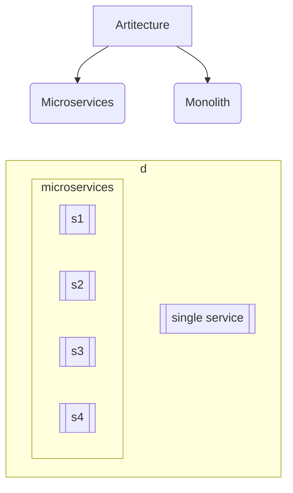

# **Monolith**

### ==Challenges==

- Overload IDE
- Scaling is hard
- Slow CI operations

### ==Advantage==

- Transaction management
- Monitoring is easy
- No management overhead

## **Microservices**

### ==Advantage==

- Management of project
- Pocket friendly scaling
- Fast CI operations

### ==Challenges==

- Transaction management, No common transaction
- Monitoring multiple services
- Improper decomposition leads to face challenges of both the architecture that includes increase in latency
- Management overhead change in one service will impact other

---

## Micro service Decomposition

> Principals Strategies and Tools

### Principals

1. Single responsibility
2. Autonomy and Independence
3. Data ownership and Decentralzation
4. Scalability and performance consederations
5. API design and communications
6. Monitoring and Observability

### Strategies

1. Buissness capability
2. Strangler pattern
3. Service decomposition by subdomain DDD
4. EDA
5. Component based decomposition

### Tools

1. Modelleing tools
   1. Event storming tools: Miro
   2. UML tools: draw.io
2. API management tools:
   1. API gateways: APIgee, Amazon API gateway
   2. API documentation: AsyncAPI doc, OpenAPI doc
3. Contanerisation and orchrestration: Docker and kubernetes
4. Service mesh: Istio
5. CI/CD: Github actions, Jenkins
6. Monitoring and logging
   1. Prometheus
   2. ELK(Elastic search, Logstash, kibana)
   3. Grafana

---

# Related

[[Design patterns]]
