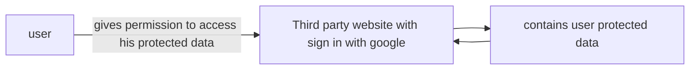
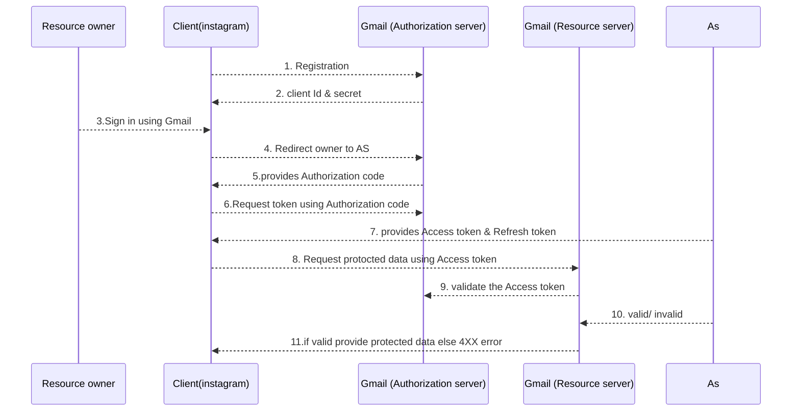

# OAUTH

OAUTH stands for _Open authorization_
Why it is used?

- It's a Authorization framework
- Enables secure third party access to user protected data



4 important roles or actors involved in it:

- Resource owner
- client
- Authorization server
- Resource hosting server

Authorization Grant Types(mechanism used by client to get access token):

- Authorization code grant

## Authorization code grant



### Sample API

#### Registration process:

```http
POST /register
Request 
{
	client_name: {my app name},
	redirect_uris: ["https://mywebsite.com/"]
}
Response 
{
	client_name: {my app nam},
	client_id: {unique id assigned},
	client_secret: {confidential info client and AS know},
}
```

#### Fetch Authorization code

```http
GET /authorize?
	response_type=code
	&client_id={id which}
	&
```

---

# Related

---

# References / Sources

[Yt Video](https://www.youtube.com/watch?v=3Gx3e3eLKrg\&list=PL6W8uoQQ2c63W58rpNFDwdrBnq5G3EfT7\&index=24)
