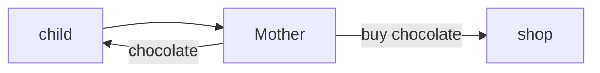
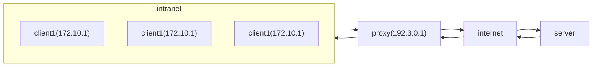
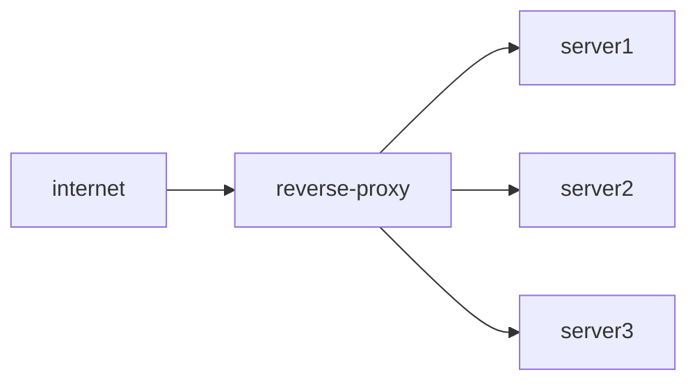
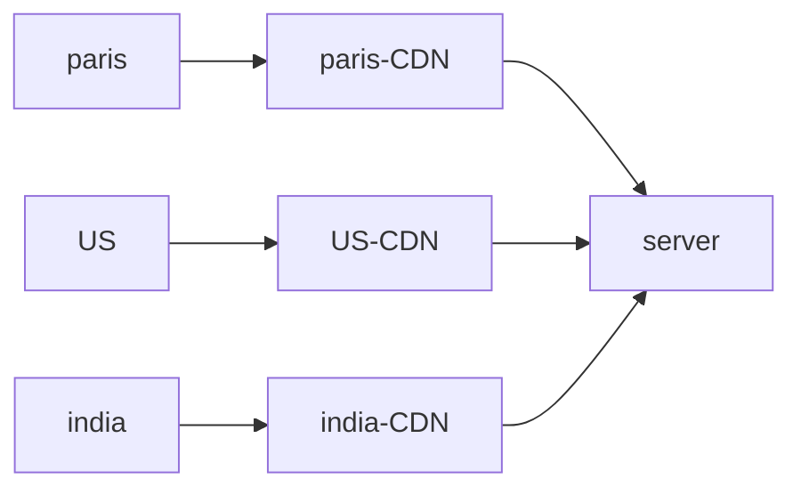
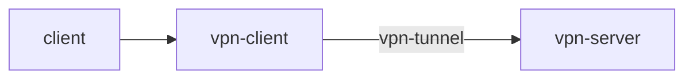

# Proxy Server

Mom acts as proxy behalf on child
child is client or group of clients, mother is proxy server, and shop is application server
proxy server sits between client and server so clients do not talk directly to server

# Proxy Types

## 1. Forward Proxy

AKA **Simple Proxy**

It hides the client network, Proxy will send its own IP to the outside world
No server can directly talk to the client

### Advantage

1. It gives anonymity to the clients
2. **Grouping of requests**, so it clubs the similar requests and send 1 request to the server and send the copies of requests to the clients
3. **Access Restricted Content**, Changing Geolocation
4. **Brings Security**, we have single point of entry towards our application layer
5. **Caching**, static content, media

### Disadvantage

It works on the **application level**, for each application or service we need to setup a proxy, there are some protocols that operate on packet level

## 2. Backward Proxy

AKA **Reverse Proxy**
No server can talk to client, it differs in the direction

> [!note]
> **CDN** is a type of reverse proxy

### Advantage

1. Security, the outside world is not aware of the server IP, in case of DDOS attacks, attacker can attack only reverse-proxy
2. **Caching**
3. **Load balancing**

---

# Proxy vs VPN

proxy act as a bypass which generally used for anonymity, hides the IP address, caching, logging,
A VPN is a much more than proxy, It is capable of encryption and decryption of data
The data transmitted using a VPN client is encrypted and served to the vpn-server where decryption happens so as to provide ultra security

# Proxy vs Load balancer

Reverse proxy can act as a load balancer but load balancer cannot act as a proxy
for a single server we do not need load balancer, but proxy might be required

# Proxy vs Firewall

in firewall we define rules what all packets can pass through one layer to another, header, port num, IP of SRC and destination, and apply rules on packets, so it works on a TCP/IP or network layer, these are known as traditional firewalls
Proxy can act as a firewall, this concept is known as proxy firewalls

---

# References / Sources

