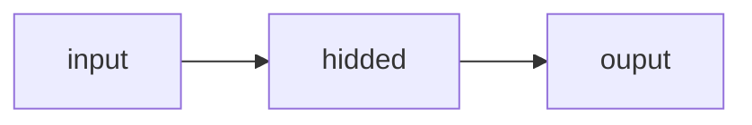

# Network of perceptrons



![[System/Assets/Pasted image 20250421040509.png]]

- There is one pattern with two features, and it can either belong to +1 class or -1 class
- In first layer we have 4 perceptron and depending on the class of initial pattern only single perceptron fires in the hidden layer
- So This model can represent any boolean function
- Each boolean function results in different set of non contradicting inequalities which can be satisfied by appropriately setting $w_{1},w_{2},w_{3},w_{4}$

# MLN for XOR

![[System/Assets/Pasted image 20250421041406.png]]

# MLN for n inputs or patterns

![[System/Assets/Pasted image 20250421041800.png]]
for n inputs we have $2^{n}$ perceptron in the hidden layer

# Theorem

Any boolean function of n IPS can be represented exactly by a MLP containing 1 hidden layer with $2^{n}$ perceptrons and one output layer containing 1 perceptron

> [!important]
> This condition for $2^{n}+1$ perceptron for constructing a boolean function is sufficient but not a necessary condition, you can implement linearly seprable functions in less than $2^{n}+1$ perceptrons

---

# Follow up

```tabs
tab: Next Lectures
| File                                                                                                                                          | created        |
| --------------------------------------------------------------------------------------------------------------------------------------------- | -------------- |
| [[Resources/Sigmoid Neuron.md\|Sigmoid Neuron]]                                                                                               | April 21, 2025 |
| [[Resources/A typical Supervised Machine Learning Setup.md\|A typical Supervised Machine Learning Setup]]                                     | April 21, 2025 |
| [[Resources/Learning Parameters (Infeasible) guess work.md\|Learning Parameters (Infeasible) guess work]]                                     | April 21, 2025 |
| [[Resources/Learning Parameters Gradient Descent.md\|Learning Parameters Gradient Descent]]                                                   | April 21, 2025 |
| [[Resources/Representation Power of Multilayer Network of Sigmoid Neurons.md\|Representation Power of Multilayer Network of Sigmoid Neurons]] | April 21, 2025 |

tab: Previous Lectures
| File                                                                                                                          | created        |
| ----------------------------------------------------------------------------------------------------------------------------- | -------------- |
| [[Resources/Linearly Separable Boolean Functions.md\|Linearly Separable Boolean Functions]]                                   | April 19, 2025 |
| [[Resources/Proof of Convergence of Perceptron Learning Algorithm.md\|Proof of Convergence of Perceptron Learning Algorithm]] | April 19, 2025 |
| [[Resources/Perceptron Learning Algorithm.md\|Perceptron Learning Algorithm]]                                                 | April 19, 2025 |
| [[Resources/Perceptrons.md\|Perceptrons]]                                                                                     | April 19, 2025 |
| [[Resources/McCulloch Pitts Neuron, Thresholding Logic.md\|McCulloch Pitts Neuron, Thresholding Logic]]                       | April 19, 2025 |

```

---

# References


