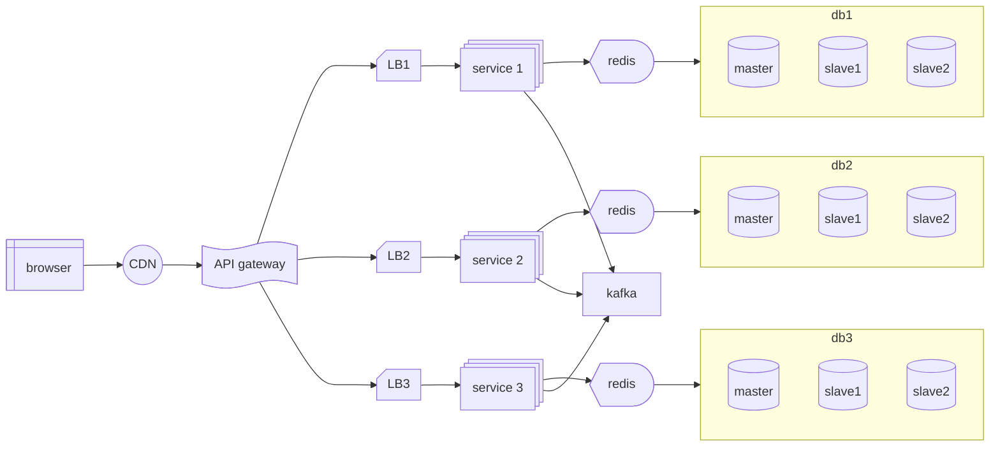

---

# Database Scaling

---

## Vertical Scaling

> CPU, RAM, Storage

---

## Horizontal Scaling

> Creating multiple instances of stateful DBs

Horizontal partitioning is recommended over vertical partitioning

![[System/Assets/b2h3rafm.bmp]]

![[System/Assets/uzpeyk6v.bmp]]

![[System/Assets/we7h7ney.bmp]]

## Challenges

1. Clustering → Consistent Hashing
2. Joining → Denormalization of Data
