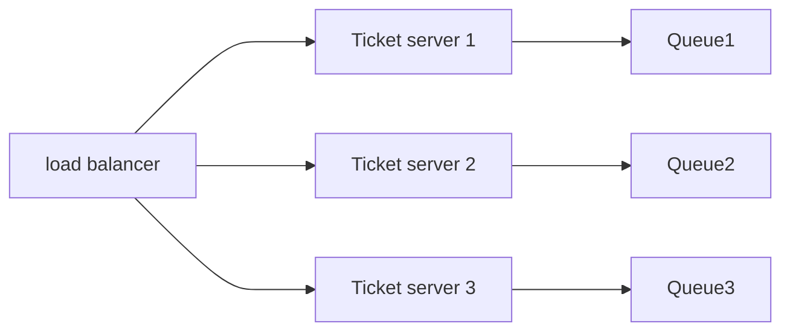

# Problem



For instant traffic our system al though auto scaling is setup might fail!!!!
At full capacity All the worker queue threads are full when a new request comes in the following can be the cases:

- Decline
- Timeout and retry

Due to resource limitation and huge request pile up and parallel request execution time to execute single request increases this can result in the timeout of the other request waiting in the queue

**Autoscaling**?
Retry requests keep on piling up and the scale up could not manage the amount of requests

**Solutions**
Rate limiting calculations is done as follows

1. Exponential Backoff $Base * 2^{n}$
2. Exponential backoff + Jitter $Base \times 2^{n} + min(\text{Max wait time}, Rdm(0, 2^{n}))$

```mermaid
flowchart LR

```

---

# Related

[[Concurrency Control]]

---

# References / Sources

[Yt Video]()
