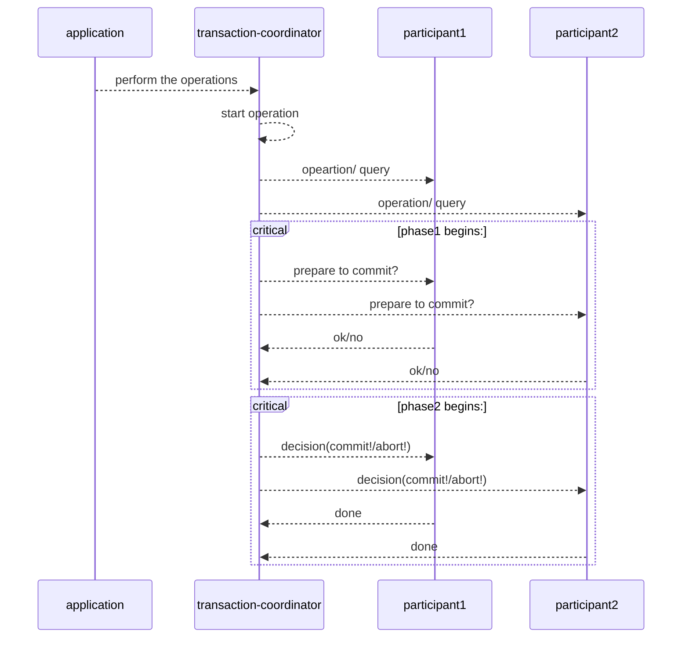
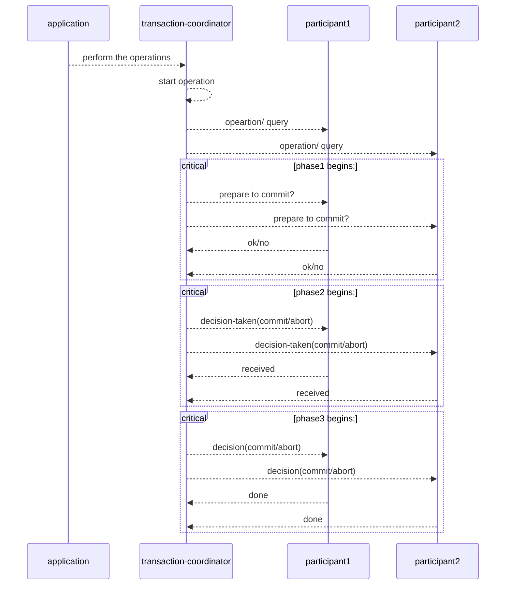
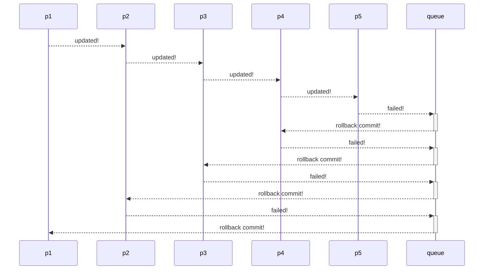

# What is Transaction?

It refers to a set of operations which need to be performed or simply say group of tasks which need to be performed against DB.
It has 4 properties:

- **Atomicity** -> All operations in a single transaction should be success or all should be fail.
- **Consistency** -> DB should be in consistent state before and after transaction
- **Isolation** -> More than one transaction that is running concurrently appears to be serialized
- **Durability** -> After transaction successfully completed, even if DB fails, data should not get lost

```transaction
Begin_transaction: DB
	- withdraw money from A: 100rs
	- deposite money to B: 100rs
	if all success:
		Do commit
	else
		Do rollback
Close_transaction
```

**How to handle this in distributed system, where operations involves multiple databases?**
OR
**As transaction is local to a particular database? How we will satisfy the transaction property in distributed system?**

```transaction
Begin_transaction:
	- update order DB
	- update inventory DB
	if all success:
		Do commit
	else
		Do rollback
Close_transaction
```

This will not work, we have three ways to handle this situation:

1. 2 phase commit -> very popular
2. 3 phase commit -> complex not that popular
3. SAGA pattern -> used very much

# Distributed Transactions

## 1. 2 phase commit

As name says, there are 2 phases in this protocol:

1. voting or prepare phase
2. decision or commit phase



### ISSUES

- Transaction coordinator fails
- participant fails
- prepare message is lost
- ok message got lost
- decision (commit/abort) message is lost

### Resolution

- coordinator and all the participants maintain a log file which is a permanent storage
- before sending any message they each service write into a log file, so if they fail and whenever they recover they can see where they left from and start form there
- if prepare message is lost safe to do abort
- if ok msg is lost then coordinator will abort the transaction
- if commit msg is lost, the participant has to wait for the coordinator to come up but the participant cannot take its own decision **Major ISSUE**

## 2. 3 phase commit

As name says there are 3 phases in this protocol, this is a non blocking protocol

1. prepare phase(same as 2 pc)
2. pre-commit phase
3. commit phase



### Resolution from 2PC

Now since the pre commit msg phase exists the participants can query each other for the coordinator decision, which brings the capability of **Non blocking**

## 3. SAGA pattern

2pc and 3pc are sync in nature while SAGA is async in nature, SAGA pattern is used when there is chain of long transactions, or sequence of transactions happening together then it is not feasible to keep logs



---

# Related

[[SQL vs NoSQL]]

---

# References / Sources


